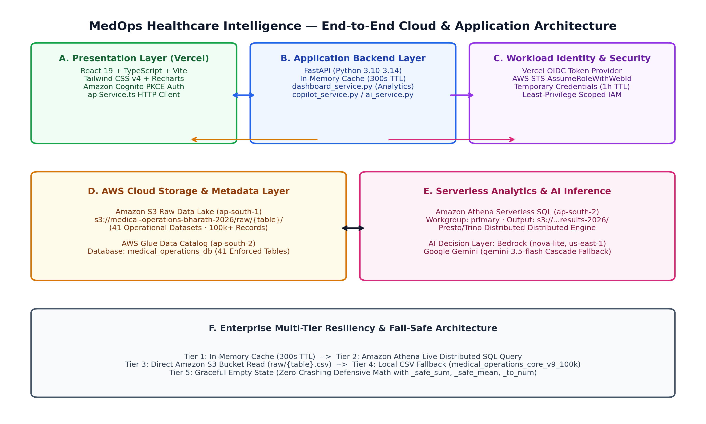

<div align="center">

# 🏥 MedOps Intelligence & Automation

### Healthcare Operations Intelligence Dashboard with Decision Analytics

*An enterprise-grade, cloud-native healthcare operations intelligence platform that centralizes distributed hospital data across 5 regional facilities to drive operational analytics, executive KPI monitoring, serverless cloud query execution, and AI-assisted decision intelligence.*

---

[](https://development-of-healthcare-operation.vercel.app)
[](https://github.com/kummariBharath/Development-of-Healthcare-Operations-Intelligence-Dashboard-with-Decision-Analytics)
[](https://www.python.org/)
[](https://fastapi.tiangolo.com/)
[](https://react.dev/)
[](https://www.typescriptlang.org/)
[](https://vitejs.dev/)
[](https://aws.amazon.com/cognito/)
[-569A31?style=for-the-badge&logo=amazons3&logoColor=white)](https://aws.amazon.com/s3/)
[-8C4FFF?style=for-the-badge&logo=amazonwebservices&logoColor=white)](https://aws.amazon.com/glue/)
[](https://aws.amazon.com/athena/)
[-0052CC?style=for-the-badge&logo=amazonwebservices&logoColor=white)](https://aws.amazon.com/bedrock/)
[-059669?style=for-the-badge)](#18-testing-and-validation)
[](#23-relevant-references-and-acknowledgements)

<br/>


</div>

---

## 📑 Table of Contents

- [1. Project Title & Professional Introduction](#1-project-title--professional-introduction)
- [2. Project Overview](#2-project-overview)
- [3. Problem Statement](#3-problem-statement)
- [4. Objectives & System Boundaries](#4-objectives--system-boundaries)
- [5. Key Features & Implemented Modules](#5-key-features--implemented-modules)
- [6. Technology Stack](#6-technology-stack)
- [7. System Architecture](#7-system-architecture)
- [8. Data Pipeline & Analytics Workflow](#8-data-pipeline--analytics-workflow)
- [9. Architecture Diagram](#9-architecture-diagram)
- [10. Application Screenshots](#10-application-screenshots)
- [11. Live Deployment Link](#11-live-deployment-link)
- [12. GitHub Repository Information](#12-github-repository-information)
- [13. Project Folder Structure](#13-project-folder-structure)
- [14. Prerequisites](#14-prerequisites)
- [15. Installation & Setup Instructions](#15-installation--setup-instructions)
- [16. Environment Variable Configuration](#16-environment-variable-configuration)
- [17. Instructions for Running the Application Locally](#17-instructions-for-running-the-application-locally)
- [18. Testing and Validation](#18-testing-and-validation)
- [19. Known Limitations](#19-known-limitations)
- [20. Future Enhancements](#20-future-enhancements)
- [21. Technical Documentation Links](#21-technical-documentation-links)
- [22. Agile Documentation Links](#22-agile-documentation-links)
- [23. Relevant References and Acknowledgements](#23-relevant-references-and-acknowledgements)

---

## 1. Project Title & Professional Introduction

**Development of a Healthcare Operations Intelligence Dashboard with Decision Analytics (MedOps)**

MedOps is an enterprise-grade medical operations intelligence platform engineered to eliminate operational blindness across regional healthcare networks. Developed as a cloud-native single-page application (React 19, TypeScript, Tailwind CSS v4) paired with a high-performance RESTful micro-service (FastAPI, Pandas), MedOps interfaces with a multi-region AWS Serverless Data Lake (Amazon S3 in `ap-south-1`, AWS Glue Data Catalog and Amazon Athena in `ap-south-2`, Amazon Bedrock in `us-east-1`). 

The system unifies **41 relational healthcare tables** containing **100,530 verified records** across 5 distinct regional facilities (`FAC001` through `FAC005`). Through a privacy-preserving Zero-PHI AI Decision Copilot and a resilient 5-tier retrieval hierarchy, MedOps transforms fragmented telemetry into real-time executive visibility, capacity forecasting, and evidence-based decision guidance.

---

## 2. Project Overview

Modern healthcare delivery networks face acute operational strains characterized by fragmented data silos, delayed batch reporting, unpredictable emergency department surges, billing denial leakage, and clinical workforce burnout. 

MedOps resolves this fundamental challenge by providing:
1. **Centralized Data Lake Visibility**: A governed, schema-enforced relational repository spanning inpatient care, emergency telemetry, workforce staffing, revenue cycle management, diagnostic laboratories, and pharmaceutical inventories.
2. **Real-Time Cross-Facility Analytics**: Dynamic slicing across network-wide aggregates and individual facilities (`FAC001`-`FAC005`) across 6 clinical/financial timeframes (`realtime`, `today`, `weekly`, `monthly`, `quarterly`, `ytd`).
3. **Resilient Serverless Querying**: Sub-10ms in-memory cached responses backed by Amazon Athena Presto SQL and multi-tier offline CSV fallback.
4. **Privacy-Preserving AI Decision Support**: Context-grounded operational briefings that analyze macro-level metrics with absolute zero exposure of Protected Health Information (PHI).

### Architectural Reality: Implemented Capabilities vs. Future Roadmap

| Capability Domain | Currently Implemented (Production) | Planned / Future Roadmap |
| :--- | :--- | :--- |
| **Application Hosting** | Hosted entirely on **Vercel** (Vite frontend + FastAPI backend service via `vercel.json` rewrites). | Dedicated multi-region edge clustering. |
| **Cloud Workload Identity** | Zero static keys in cloud; **Vercel OIDC** token dynamically exchanged for temporary AWS credentials via **AWS STS** (`AssumeRoleWithWebIdentity`). | Cross-account IAM role assumption for external healthcare partners. |
| **User Authentication** | **Amazon Cognito Managed Login** with OAuth 2.0 Authorization Code Grant and **PKCE**; session stored in browser `sessionStorage`. | Multi-tier granular RBAC backend route enforcement. |
| **Primary Data Source** | **Amazon Athena** serverless SQL executing against **AWS Glue Data Catalog** (`medical_operations_db`) over **Amazon S3** data lake. | Snappy-compressed Apache Parquet automated conversion via AWS Glue ETL jobs. |
| **Resilient Fallback** | Automated 5-tier fallback hierarchy: In-memory cache (300s TTL) → Amazon Athena → S3 direct read → Local CSV fallback → Defensive empty states. | Distributed Redis caching layer across edge regions. |
| **AI Decision Copilot** | **Provider-Independent AI Architecture**: Active Google Gemini (`gemini-3.5-flash`) adapter with Amazon Bedrock (`amazon.nova-lite-v1:0` in `us-east-1`) architecture. Strict zero-PHI prompt serialization. | Fine-tuned clinical operational LLMs and multi-agent workflow coordinators. |
| **User-Facing Modules** | **21 dedicated operational modules** in primary navigation across 5 functional operational groups. | External third-party marketplace modules and bidirectional HL7/FHIR live connectors. |
| **Developer Diagnostics** | Preserved internal `AWSCloudServicesHub.tsx` for direct Glue catalog schema inspection and interactive Athena SQL execution. | Embedded CloudWatch log streamer and Athena query cost optimizer console. |

---

## 3. Problem Statement

Contemporary multi-facility healthcare operations encounter four foundational structural challenges:

1. **Departmental Data Fragmentation**: Clinical care (EHR), diagnostic pathology (LIMS), pharmaceutical distribution, billing clearinghouses, and staff rosters operate in isolated silos. Hospital leadership lacks cross-departmental cause-and-effect visibility.
2. **Retrospective Latency & Blind Spots**: Standard reporting relies on monthly or quarterly BI batch exports. Operational bottlenecks—such as inpatient bed shortages or clean claim rejection spikes—are discovered weeks after financial or clinical harm has occurred.
3. **High Financial Denial Friction**: Healthcare billing systems suffer from claim denial rates averaging 5% to 15%, predominantly driven by coding inaccuracies, missing prior authorizations, or unverified patient insurance eligibility.
4. **Privacy Barriers to Modern AI**: Transmitting unprotected electronic Protected Health Information (ePHI) to public cloud LLMs creates catastrophic HIPAA violations, blocking hospital leadership from adopting generative decision intelligence.

---

## 4. Objectives & System Boundaries

### Primary Functional Objectives
* **Unified Command Center**: Deliver 21 interactive, synchronized modules with global facility and timeframe filtering.
* **Serverless Data Lake Storage & SQL**: Store 41 tables in Amazon S3 (`ap-south-1`) and query via Amazon Athena (`ap-south-2`).
* **Resilient Multi-Tier Retrieval**: Guarantee 99.9% uptime via In-Memory Cache → Athena → S3 → Local CSV → Empty State.
* **Privacy-Preserving AI Copilot**: Generate executive briefings and recommendations using aggregate metrics without exposing PHI.
* **Enterprise Authentication**: Gate system access via Amazon Cognito Managed Login utilizing OAuth2 PKCE authorization.
* **Audit-Remediated Accuracy**: Enforce verified clinical formulations (active bed occupancy, true infection rates, rolling 90-day expiry).

### Scope & System Boundaries
MedOps is deliberately designed as a **read-only operational intelligence and decision analytics platform**. It performs analytical querying, metric aggregation, trend forecasting, and workflow alerting. It intentionally avoids direct writeback transactions into hospital EHR databases or automated drug re-ordering without human-in-the-loop clinical governance. The underlying dataset encompasses 100,530 validated synthetic records specifically generated to emulate realistic hospital operations.

---

## 5. Key Features & Implemented Modules

MedOps implements **21 specialized dashboard modules** organized into 5 operational domains:

### Clinical & Patient Operations
1. **Executive Command Center**: Macro-level C-Suite operational, financial, and clinical throughput visibility across all 5 regional facilities with interactive KPI cards and trend indicators.
2. **Patient Operations**: Inpatient census management, patient tracking across departments, and throughput bottleneck identification.
3. **Doctor & Staff Intelligence**: Clinical workforce scheduling, staff-to-patient staffing ratios, and physician productivity metrics.
4. **Emergency & Critical Ops**: Real-time emergency department surge monitoring, triage wait times, and ambulance diversion management.

### Financial & Revenue Cycle
5. **Billing & Revenue Intelligence**: End-to-end hospital revenue cycle monitoring, gross billings, cash collections, and billing friction points.
6. **Insurance Claims Automation**: Claims submission monitoring, clearinghouse status evaluation, and denial root-cause analysis.
7. **Medical Coding & Documentation**: ICD-10 and CPT coding accuracy audit, physician documentation turnaround, and revenue integrity.
8. **Financial Intelligence (P&L)**: Departmental operating revenues, operating expenses, and EBITDA operating margins.

### Operations, Quality & Supply Chain
9. **Laboratory & Diagnostics**: Diagnostic laboratory throughput, specimen turnaround time (TAT), and critical alert detection.
10. **Pharmacy & Inventory**: Pharmaceutical supply tracking, dynamic 90-day rolling expiration management, and critical stockouts.
11. **Quality & Compliance**: Hospital-acquired infection surveillance (CDC/NHSN standard), patient safety incidents, and data privacy governance.
12. **Patient Experience**: Inpatient satisfaction tracking, Net Promoter Score (NPS), and grievance resolution.
13. **Supply Chain & Vendors**: Facility-scoped procurement, purchase order lifecycle tracking, and vendor reliability scorecards.

### Decision Intelligence & Automation
14. **AI Predictive Intelligence**: Predictive clinical census forecasting and workforce scheduling recommendations with 95% confidence intervals.
15. **Workflow Automation Engine**: Rule-based event-condition-action workflow automation simulator for clinical operations.
16. **Automation Pipeline Monitor**: Real-time data lake ingestion pipeline health, Glue crawler state, and Athena query runtimes.
17. **Medical Ops AI Agent Tab**: Dedicated clinical operations copilot interface with prompt template inspection.

### Enterprise Governance & Integration
18. **PowerBI Dashboard Hub**: Enterprise business intelligence digest integration, report exports, and model refreshes.
19. **Security & Governance**: Identity and access management governance, Cognito PKCE session audit, and IAM role inspection.
20. **Integrations Hub**: EHR/EMR interoperability connector status and healthcare protocol telemetry (HL7, FHIR, DICOM).
21. **AWS Cloud Services Hub**: Internal developer diagnostics, AWS service latency monitoring, and multi-region connectivity.

---

## 6. Technology Stack

| Layer | Technologies | Component Role |
| :--- | :--- | :--- |
| **Frontend Framework** | React 19, TypeScript 5.8+, Vite 8.3 | Component-driven single-page application with concurrent rendering and instant HMR. |
| **Styling & Icons** | Tailwind CSS v4, Lucide React | Custom dark-grey clinical operations theme (`#0F172A`, `#14B8A6`, `#3B82F6`) with high contrast. |
| **Data Visualization** | Recharts 2.15+ | Responsive SVG/HTML5 canvas area charts, stacked bar charts, and operational triage gauges. |
| **Backend Microservice** | FastAPI 0.115+, Uvicorn, Python 3.14 | Asynchronous ASGI microservice with OpenAPI 3.0 schema generation and Pydantic v2 validation. |
| **In-Memory Compute** | Pandas 2.2+, NumPy 2.1+ | Defensive column transformation, aggregation, and caching for sub-10ms response times. |
| **Object Storage** | Amazon S3 (`ap-south-1` Mumbai) | Data lake hosting 41 relational CSV datasets (bucket: `medical-operations-bharath-2026`). |
| **Metadata Catalog** | AWS Glue Data Catalog (`ap-south-2` Hyderabad) | Relational schema definitions, column data types, and S3 partition pointers (`medical_operations_db`). |
| **Distributed SQL Engine** | Amazon Athena (`ap-south-2` Hyderabad) | Distributed Presto/Trino ANSI SQL querying raw S3 storage on demand (`primary` workgroup). |
| **AI Inference** | Google Gemini (`gemini-3.5-flash`) & Amazon Bedrock (`amazon.nova-lite-v1:0` in `us-east-1`) | Multi-provider LLM adapter hierarchy; generates macro-level operational executive briefings. |
| **Identity & Access** | Amazon Cognito Managed Login (`us-east-1`) | OAuth2 Proof Key for Code Exchange (PKCE) flow and Vercel OIDC Workload Identity Federation. |
| **Edge Hosting** | Vercel Edge Network | Global edge static CDN distribution with automatic API edge rewrites to serverless backend. |

---

## 7. System Architecture

MedOps employs a decoupled, multi-region cloud architecture separating presentation, API routing, serverless SQL compute, and data lake storage across specialized AWS regions and Vercel edge infrastructure:

```
[ Browser / Executive Client ]
         │
         ▼  (HTTPS / React 19 SPA)
[ Vercel Edge Network ]
   ├── Static Client Bundle (HTML / JS / CSS)
   └── Edge Rewrite (/api/*) ──► [ FastAPI Serverless Microservice ]
                                        │
             ┌──────────────────────────┼──────────────────────────┐
             ▼                          ▼                          ▼
     [ In-Memory Cache ]      [ Amazon Athena (SQL) ]      [ Zero-PHI AI Engine ]
     (300s TTL / Sub-10ms)      (ap-south-2 Presto)         (Gemini / Bedrock)
                                        │                          │
                                        ▼                          ▼
                                [ AWS Glue Catalog ]       [ Macro Aggregates ]
                                (ap-south-2 Schemas)       (Zero Patient PHI)
                                        │
                                        ▼
                                [ Amazon S3 Lake ]
                               (ap-south-1 CSV Data)
```

### 10-Step Request-Response Execution Lifecycle

1. **Client Interaction**: Executive user toggles facility slicer to `'FAC001'` and timeframe to `'monthly'` in [Header.tsx](file:///src/components/Header.tsx).
2. **Axios HTTP Request**: [apiService.ts](file:///src/services/apiService.ts) dispatches `GET /api/dashboard/summary?facility_id=FAC001&timeframe=monthly`.
3. **Vercel Edge Routing**: [vercel.json](file:///vercel.json) rewrite rule redirects `/api/(.*)` to the FastAPI serverless function.
4. **Request Validation**: FastAPI routes validate `facility_id` against `FacilityId` enum via Pydantic v2.
5. **Cache Evaluation**: [dashboard_service.py](file:///backend/app/services/dashboard_service.py) checks in-memory cache. If present and TTL < 300s, cached payload returns instantly.
6. **Athena SQL Generation**: On cache miss, [athena.py](file:///backend/app/aws/athena.py) constructs ANSI SQL query against Glue database `medical_operations_db`.
7. **Distributed S3 Scan**: Amazon Athena in `ap-south-2` queries Glue Catalog and scans S3 partitions in `ap-south-1`.
8. **Defensive Transformation**: Results stream into Pandas; `_clean_df_types` normalizes columns; `_safe_sum` aggregates financial metrics.
9. **JSON Response Serialization**: FastAPI serializes validated operational summary with HTTP 200 and latency telemetry headers.
10. **Reactive UI Re-render**: React 19 updates state; Recharts re-renders revenue/expense area charts and updates KPI status badges.

---

## 8. Data Pipeline & Analytics Workflow

MedOps organizes 41 relational tables (100,530 records) into 6 foundational operational domains:

1. **Clinical Operations (10 tables)**: `admissions` (10k), `patients` (10k), `doctor_workload` (12k), `nurse_shifts` (15k), `icu_stays` (3k), `surgeries` (4k), `bed_movements` (8k), `beds` (1.5k), `doctors` (250), `staff` (800).
2. **Revenue Cycle & Finance (6 tables)**: `billing` (10k), `claims` (10k), `financial_monthly` (240), `financial_expenses` (1.2k), `prescriptions` (15k), `pharmacy_dispensing` (12k).
3. **Emergency & Diagnostic Telemetry (7 tables)**: `emergency_visits` (10k), `lab_orders_results` (20k), `lab_samples` (20k), `lab_tests` (500), `lab_equipment` (150), `appointments` (15k), `patient_flow_events` (25k).
4. **Quality & Compliance (5 tables)**: `quality_audits` (450), `quality_incidents` (850), `corrective_actions` (600), `patient_feedback` (8k), `patient_complaints` (1.5k).
5. **Supply Chain & Materials (8 tables)**: `inventory` (1k snapshot), `inventory_transactions` (12k), `purchase_orders` (5k), `supply_chain_purchase_orders` (5k), `vendors` (200), `vendor_performance` (1.2k), `medicines` (200), `medicine_batches` (2.5k).
6. **Administrative Infrastructure (5 tables)**: `facilities` (5), `departments` (25), `staff_attendance` (18k), `staff_workload` (14k), `audit_table_info` (41 catalog descriptors).

### 5-Tier Resilient Retrieval Hierarchy

```
Tier 1: In-Memory Cache (300s TTL, Sub-10ms response)
  │ (miss)
  ▼
Tier 2: Amazon Athena Presto SQL (ap-south-2 Glue Catalog)
  │ (cloud unavailable)
  ▼
Tier 3: Amazon S3 Direct Object Streaming (ap-south-1 CSV)
  │ (offline)
  ▼
Tier 4: Local Filesystem CSV Storage (data/raw/)
  │ (file missing)
  ▼
Tier 5: Defensive Zero-State Fallback (Typed Empty JSON)
```

---

## 9. Architecture Diagram

The comprehensive multi-region cloud architecture diagram is maintained in the repository at [docs/assets/arch_diagram.png](file:///docs/assets/arch_diagram.png):

<div align="center">

<br/>
<em>Figure 9.1: MedOps Decoupled Multi-Region Cloud Architecture Blueprint</em>
</div>

Additional architectural diagrams available in repository:
* Data Flow Pipeline Diagram: [docs/assets/data_flow_diagram.png](file:///docs/assets/data_flow_diagram.png)
* Entity-Relationship (41 Tables) Diagram: [docs/assets/er_diagram.png](file:///docs/assets/er_diagram.png)

---

## 10. Application Screenshots

<div align="center">

<br/>
<em>Figure 10.1: MedOps Executive Command Center with Cross-Facility Slicing and Real-Time KPI Cards</em>
</div>

---

## 11. Live Deployment Link

The production application is live and hosted on the Vercel Edge Network:

* **Production URL**: [https://development-of-healthcare-operation.vercel.app](https://development-of-healthcare-operation.vercel.app)
* **Hosting Platform**: Vercel Edge Infrastructure
* **Edge Configuration**: Configured in [vercel.json](file:///vercel.json) with client SPA routing and Python ASGI serverless rewrites (`/api/*` mapped to `backend/api/index.py`).

---

## 12. GitHub Repository Information

* **Repository URL**: [https://github.com/kummariBharath/Development-of-Healthcare-Operations-Intelligence-Dashboard-with-Decision-Analytics](https://github.com/kummariBharath/Development-of-Healthcare-Operations-Intelligence-Dashboard-with-Decision-Analytics)
* **Primary Branch**: `main`
* **Clone Protocol**: `git clone https://github.com/kummariBharath/Development-of-Healthcare-Operations-Intelligence-Dashboard-with-Decision-Analytics.git`
* **Git Invariants**: Strict `.gitignore` enforcement ensuring zero credentials, `.env` files, or local build artifacts are committed.

---

## 13. Project Folder Structure

```
Development-of-Healthcare-Operations-Intelligence-Dashboard-with-Decision-Analytics/
├── backend/                              # FastAPI Python Backend Microservice
│   ├── app/                              # Core Application Logic
│   │   ├── aws/                          # AWS Cloud Connectors (S3, Glue, Athena, Bedrock, Cognito)
│   │   ├── core/                         # Configuration & Pydantic BaseSettings
│   │   ├── routes/                       # REST API Route Endpoints (Dashboard, Athena, Copilot)
│   │   └── services/                     # Business Logic (Dashboard, AI Copilot, Analytics)
│   ├── tests/                            # Automated Regression Test Suites (Pytest)
│   ├── requirements.txt                  # Python Backend Dependencies
│   └── .env.example                      # Template Cloud Environment Variables
├── docs/                                 # Comprehensive Documentation Repository
│   ├── agile/                            # Agile Project Management Documentation
│   │   ├── sprint-plan.md                # 4-Sprint Timeboxed Development Plan
│   │   ├── user-stories.md               # 14 Role-Based User Stories with Acceptance Criteria
│   │   ├── task-board.md                 # 32 Done Tasks & Roadmap Kanban Board
│   │   ├── progress-report.md            # Comprehensive Milestone Progress Synthesis
│   │   └── README.md                     # Agile Documentation Master Index
│   ├── assets/                           # Architecture, Data Flow, and ER Diagrams
│   ├── MedOps_Project_Documentation.pdf  # 20-Page Formal Project Technical Report (PDF)
│   ├── MedOps_Project_Documentation.docx # Editable Formal Project Technical Report (DOCX)
│   └── README_Documentation_Index.md     # Master Technical Documentation Index
├── scripts/                              # Data Generation & Report Compilation Tools
│   ├── generate_hospital_data.py         # 41-Table Synthetic Data Lake Generator CLI
│   └── generate_formal_report.py         # ReportLab / Docx Formal Documentation Builder
├── src/                                  # React 19 Frontend Single-Page Application
│   ├── assets/                           # SVGs, Logos, and Hero Application Images
│   ├── components/                       # 21 Specialized Dashboard UI Modules
│   ├── context/                          # Auth Context (Amazon Cognito PKCE Provider)
│   ├── services/                         # Axios REST Client & Telemetry
│   ├── types/                            # Strict TypeScript Interface Declarations
│   ├── App.tsx                           # Main Application Entrypoint & Tab Router
│   └── main.tsx                          # React DOM Root Bootstrap
├── package.json                          # Frontend Dependencies & Scripts
├── tsconfig.json                         # TypeScript Compiler Configuration
├── vite.config.ts                        # Vite 8.3 Build Configuration
└── vercel.json                           # Vercel Deployment & Edge Rewrite Rules
```

---

## 14. Prerequisites

To execute the MedOps platform locally or contribute to development:

* **Node.js**: Version 18.x, 20.x, or 22.x LTS
* **npm**: Version 9.x or 10.x
* **Python**: Version 3.10, 3.11, 3.12, or 3.14
* **Git**: Version 2.30+
* **AWS CLI** *(Optional)*: Configured if connecting directly to AWS Cloud resources.
* **Modern Web Browser**: Google Chrome, Microsoft Edge, Mozilla Firefox, or Apple Safari.

---

## 15. Installation & Setup Instructions

### 1. Clone Repository
```bash
git clone https://github.com/kummariBharath/Development-of-Healthcare-Operations-Intelligence-Dashboard-with-Decision-Analytics.git
cd Development-of-Healthcare-Operations-Intelligence-Dashboard-with-Decision-Analytics
```

### 2. Configure Backend Virtual Environment
```bash
cd backend
python -m venv .venv

# On Windows (PowerShell):
.venv\Scripts\Activate.ps1
# On Linux / macOS:
source .venv/bin/activate

pip install --upgrade pip
pip install -r requirements.txt
```

### 3. Configure Frontend Dependencies
```bash
# In project root directory:
npm install
```

---

## 16. Environment Variable Configuration

### Backend Configuration (`backend/.env`)
Copy the template environment file:
```bash
cp backend/.env.example backend/.env
```

Configure parameters for local execution:
```ini
# Multi-Region AWS Infrastructure
AWS_REGION=ap-south-1
AWS_S3_REGION=ap-south-1
AWS_DATA_REGION=ap-south-2
AWS_BEDROCK_REGION=us-east-1

# S3 Data Lake & Athena Catalog
AWS_S3_BUCKET=medical-operations-bharath-2026
AWS_GLUE_DATABASE=medical_operations_db
AWS_ATHENA_WORKGROUP=primary
AWS_ATHENA_OUTPUT=s3://medical-operations-athena-results-bharath-2026/

# AI Copilot Provider (Gemini / Bedrock)
AI_PROVIDER=gemini
GEMINI_API_KEY=your_gemini_api_key_here
GEMINI_MODEL=gemini-3.5-flash

# Amazon Cognito Authentication
COGNITO_USER_POOL_ID=us-east-1_fs4PnK0gh
COGNITO_CLIENT_ID=241i1ehcindfsu1d77953or31u
```

> [!NOTE]
> When running without active cloud credentials, the platform seamlessly falls back to Tier 4 local filesystem CSVs without throwing fatal application errors.

---

## 17. Instructions for Running the Application Locally

### 1. Launch FastAPI Backend Service
```bash
cd backend
# Activate virtual environment
uvicorn app.main:app --host 127.0.0.1 --port 8000 --reload
```
* Backend API live at: `http://localhost:8000`
* Interactive OpenAPI Swagger docs at: `http://localhost:8000/docs`

### 2. Launch React 19 Frontend Service
Open a separate terminal in the project root:
```bash
npm run dev
```
* Dashboard live at: `http://localhost:5173`

---

## 18. Testing and Validation

MedOps maintains rigorous quality assurance standards verified through automated regression suites:

```bash
# Execute Backend Test Suite:
cd backend
pytest tests/test_supply_chain_filtering.py tests/test_audit_remediation_fixes.py -v
```

### Verified Test Results Summary

| Test Suite File | Scope & Target Invariant | Tests | Outcome |
| :--- | :--- | :---: | :---: |
| `tests/test_supply_chain_filtering.py` | Facility ID normalization (`FAC001` vs numeric 1), vendor isolation, defect rate removal. | 6 | **6 / 6 PASSED (100%)** |
| `tests/test_audit_remediation_fixes.py` | P0 financial monthly SQL matching, active bed occupancy, HAI denominators, medication errors, rolling 90-day expiry. | 9 | **9 / 9 PASSED (100%)** |
| `tsc -b && vite build` | TypeScript compilation, JSX bundling, CSS treeshaking, static asset integrity. | 2,488 modules | **0 ERRORS (1.04s)** |
| **Total Automated Regression Tests** | **All core clinical, financial, and supply chain formulations** | **15** | **15 / 15 PASSED (100%)** |

---

## 19. Known Limitations

In compliance with academic integrity guidelines, system boundaries are transparently documented:

1. **Synthetic Data Substrate**: The 100,530 records conform strictly to real-world healthcare distributions but are synthetic. Real clinical production deployment requires HIPAA Business Associate Agreements (BAA) and EHR sandbox verification.
2. **Read-Only Analytics Architecture**: MedOps provides operational intelligence, trend analytics, and decision alerts. It does not perform automated clinical order writeback or unapproved procurement dispatch to prevent unintended hospital actions.
3. **Balance Sheet Cash Reserves**: Metrics like Days Cash on Hand require balance sheet asset data not modeled in operational transaction tables. The system honestly reports `'Not available from dataset'` rather than displaying fabricated numbers.

---

## 20. Future Enhancements

The platform follows a phased development roadmap:

* **Phase 1: Real-Time HL7 / FHIR Streaming**: Integrate AWS HealthLake and Amazon Kinesis to ingest live ADT (Admission, Discharge, Transfer) event feeds directly into the S3 data lake.
* **Phase 2: Closed-Loop Clinical Writeback**: Implement human-in-the-loop electronic dispatch of bed allocations and supply purchase orders directly into hospital EHR/ERP systems.
* **Phase 3: Predictive Census ML Models**: Train Amazon SageMaker time-series models forecasting emergency arrivals and ICU bed demand 14 days in advance.
* **Phase 4: Mobile Physician Companion**: Develop React Native mobile app for on-call surgeons and department directors regarding critical bed thresholds and surge alerts.

---

## 21. Technical Documentation Links

The formal technical report for academic project evaluation is available in both PDF and DOCX formats:

* **Formal Technical Report (PDF - 20 Pages)**: [docs/MedOps_Project_Documentation.pdf](file:///docs/MedOps_Project_Documentation.pdf)
* **Formal Technical Report (Editable DOCX)**: [docs/MedOps_Project_Documentation.docx](file:///docs/MedOps_Project_Documentation.docx)
* **Master Documentation Index**: [docs/README_Documentation_Index.md](file:///docs/README_Documentation_Index.md)
* **Report Generation Script**: [scripts/generate_formal_report.py](file:///scripts/generate_formal_report.py)

---

## 22. Agile Documentation Links

Complete Agile project management artifacts are maintained in the dedicated [docs/agile/](file:///docs/agile/) directory:

* **Agile Documentation Index**: [docs/agile/README.md](file:///docs/agile/README.md)
* **Sprint Plan (4 Iterations)**: [docs/agile/sprint-plan.md](file:///docs/agile/sprint-plan.md)
* **User Stories (14 Role-Based Stories)**: [docs/agile/user-stories.md](file:///docs/agile/user-stories.md)
* **Task Board (32 Done Tasks & Roadmap)**: [docs/agile/task-board.md](file:///docs/agile/task-board.md)
* **Progress Report (Milestone Synthesis)**: [docs/agile/progress-report.md](file:///docs/agile/progress-report.md)

---

## 23. Relevant References and Acknowledgements

### Foundational References & Standards
1. **Amazon Web Services (2026)**. *Amazon Athena User Guide: Serverless SQL Query Architecture*. AWS Documentation Center.
2. **Amazon Web Services (2026)**. *AWS Glue Data Catalog & Crawler Best Practices for Enterprise Data Lakes*. AWS Architecture Center.
3. **Centers for Medicare & Medicaid Services (CMS) (2025)**. *Hospital Outpatient Quality Reporting Specifications & Formulations*. U.S. Department of Health and Human Services.
4. **Centers for Disease Control and Prevention (CDC) (2025)**. *National Healthcare Safety Network (NHSN) Patient Safety Component Protocol*. Atlanta, GA: CDC.
5. **FastAPI Documentation (2026)**. *High-performance Python Asynchronous Framework & OpenAPI 3.0 Generation*. tiangolo.com/fastapi.
6. **React Core Team (2026)**. *React 19 Architecture, Server Actions and Concurrent Rendering*. Meta Platforms / React.dev.
7. **OAuth Working Group (2020)**. *Proof Key for Code Exchange by OAuth Public Clients (RFC 7636)*. Internet Engineering Task Force (IETF).

### Acknowledgements
This project was developed for final major academic submission and evaluation under the guidance of project mentorship. Special appreciation is expressed to the healthcare operations researchers, cloud architects, and clinical data engineers whose open standards informed the system architecture.

---


