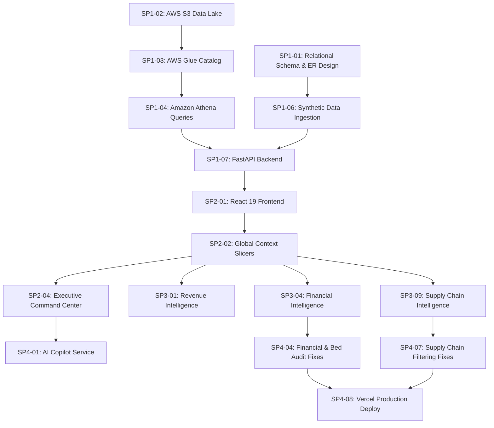

# MedOps Agile Sprint Plan

**Project Title:** Development of a Healthcare Operations Intelligence Dashboard with Decision Analytics (MedOps)  
**Methodology:** Agile Scrum (Two-Week Timeboxed Sprints)  
**Lifecycle Horizon:** Sprints 1 through 4 (Architecture, Implementation, Integration, Hardening)  
**Target Audience:** Project Mentors, Technical Evaluators, Engineering Team  
**Last Updated:** October 2026  

---

## 1. Project Goals & Vision

MedOps was conceived to eliminate departmental data silos across regional hospital networks by unifying clinical, operational, financial, and supply chain telemetry into a single, high-performance command center. 

### Core Goals:
1. **Unified Operational Visibility:** Aggregate 41 distinct relational healthcare datasets across 5 network facilities (`FAC001` through `FAC005`) into interactive, low-latency analytical views.
2. **Serverless Cloud Analytics:** Establish a resilient, multi-region AWS cloud pipeline utilizing Amazon S3 for data lake storage, AWS Glue for cataloging, and Amazon Athena for distributed serverless SQL queries.
3. **Resilient Multi-Tier Data Architecture:** Guarantee zero application downtime through a robust fallback hierarchy (In-Memory Cache $\rightarrow$ Amazon Athena $\rightarrow$ Direct S3 Stream $\rightarrow$ Local Dataset $\rightarrow$ Defensive Safe State).
4. **Zero-PHI Decision Intelligence:** Provide clinical leaders with contextual decision support via large language models (Google Gemini and Amazon Bedrock Nova-Lite), enforcing strict zero-Protected Health Information (PHI) grounding.
5. **Enterprise Security & Compliance:** Enforce OpenID Connect authentication via Amazon Cognito Managed Login with PKCE and secure serverless backend execution via Vercel Workload Identity Federation.

---

## 2. Sprint Cadence & Release Schedule

The project was executed across four timeboxed sprints reflecting the actual development milestones:

| Sprint | Timeline Focus | Primary Theme | Delivery Milestone | Status |
| :--- | :--- | :--- | :--- | :--- |
| **Sprint 1** | Foundations & Ingestion | Data Engineering, AWS Lake & Schema Design | Synthetic Hospital Data Lake & Baseline APIs | **COMPLETED** |
| **Sprint 2** | Core Command Center | Executive, Patient & Staff Operations | Core Dashboard Views & Multi-Facility Slicers | **COMPLETED** |
| **Sprint 3** | Domain Intelligence | Revenue Cycle, Diagnostics, Supply & Quality | Specialized Modules & Analytical Formulations | **COMPLETED** |
| **Sprint 4** | Hardening & AI Copilot | Audit Remediation, Zero-PHI AI & Production | Passing Test Suite & Vercel Production Deploy | **COMPLETED** |

---

## 3. Sprint Breakdown

### Sprint 1: Foundational Architecture, Synthetic Ingestion & AWS Data Lake

#### Sprint Objectives:
* Design relational healthcare schema encompassing 41 operational datasets.
* Provision multi-region AWS infrastructure: S3 bucket in `ap-south-1` (Mumbai), Glue Data Catalog and Athena in `ap-south-2` (Hyderabad).
* Develop reproducible, schema-conforming synthetic data generator (`scripts/generate_hospital_data.py`).
* Construct FastAPI backend scaffold with AWS Boto3 integration and local development fallbacks.

#### Planned Deliverables & Priorities:
| Task ID | Deliverable / Task Description | Priority | Dependencies | Expected Outcome | Actual Status | Evidence |
| :--- | :--- | :--- | :--- | :--- | :--- | :--- |
| **SP1-01** | Define 41 healthcare dataset schemas & ER relationships | **P0** | None | Normalised relational model | **DONE** | `dataset/` CSVs, `docs/assets/er_diagram.png` |
| **SP1-02** | Provision AWS S3 bucket (`medical-operations-bharath-2026`) | **P0** | AWS IAM | Durable cloud object storage | **DONE** | `backend/app/aws/s3.py`, `scripts/upload_expanded_data.py` |
| **SP1-03** | Register Glue Data Catalog database (`medical_operations_db`) | **P0** | SP1-02 | Serverless table catalog | **DONE** | `backend/app/aws/glue.py`, `scripts/inspect_candidate_schemas.py` |
| **SP1-04** | Configure Amazon Athena workgroup and output location | **P0** | SP1-03 | Serverless ANSI SQL query engine | **DONE** | `backend/app/aws/athena.py`, Athena console verification |
| **SP1-05** | Build synthetic generator CLI with Glue location check | **P1** | SP1-01, SP1-03 | Schema-validated generator | **DONE** | `scripts/generate_hospital_data.py`, `scripts/README.md` |
| **SP1-06** | Ingest 100,530 baseline records across 5 facilities | **P0** | SP1-01, SP1-05 | Baseline dataset populated | **DONE** | `dataset/medical_operations_core_v9_100k/` |
| **SP1-07** | Initialize FastAPI server with health check route | **P0** | None | Operational REST entrypoint | **DONE** | `backend/app/main.py`, `/api/health` |

---

### Sprint 2: Core Operational Command Center & Real-Time Slicers

#### Sprint Objectives:
* Build the modern dark-themed React 19 single-page application using Tailwind CSS v4 and Lucide React.
* Implement top-level global filter bar (Facility selection `FAC001`-`FAC005` + All Facilities, and Timeframe selection: Realtime, Today, Weekly, Monthly, Quarterly, YTD).
* Develop Executive Command Center module with enterprise KPI cards and Recharts visualizations.
* Develop Patient Operations, Doctor & Staff Intelligence, and Emergency Critical Operations modules.

#### Planned Deliverables & Priorities:
| Task ID | Deliverable / Task Description | Priority | Dependencies | Expected Outcome | Actual Status | Evidence |
| :--- | :--- | :--- | :--- | :--- | :--- | :--- |
| **SP2-01** | Scaffold React 19 + TypeScript + Vite frontend project | **P0** | None | Modern responsive SPA | **DONE** | `src/App.tsx`, `vite.config.ts`, `package.json` |
| **SP2-02** | Implement Header with Global Facility & Timeframe Slicers | **P0** | SP2-01 | Network-wide context state | **DONE** | `src/components/layout/Header.tsx` |
| **SP2-03** | Implement Sidebar navigation with module categorization | **P0** | SP2-01 | Collapsible responsive navigation | **DONE** | `src/components/layout/Sidebar.tsx` |
| **SP2-04** | Develop Executive Command Center module | **P0** | SP1-07, SP2-02 | C-Suite operational dashboard | **DONE** | `src/components/modules/ExecutiveCommandCenter.tsx` |
| **SP2-05** | Develop Patient Operations module (Admissions, Flow, Beds) | **P1** | SP2-02 | Patient census & bed analytics | **DONE** | `src/components/modules/PatientOperations.tsx` |
| **SP2-06** | Develop Doctor & Staff Intelligence module (Workload, Ratios) | **P1** | SP2-02 | Clinician scheduling & capacity | **DONE** | `src/components/modules/DoctorStaffIntelligence.tsx` |
| **SP2-07** | Develop Emergency & Critical Operations module (Triage, Waits) | **P1** | SP2-02 | Real-time ED wait & triage metrics | **DONE** | `src/components/modules/EmergencyCriticalOperations.tsx` |
| **SP2-08** | Implement thread-safe in-memory caching in backend (`300s TTL`) | **P0** | SP1-07 | Sub-10ms response on cache hit | **DONE** | `backend/app/services/dashboard_service.py` (`_TABLE_CACHE`) |

---

### Sprint 3: Domain Intelligence, Quality, Financials & Supply Chain

#### Sprint Objectives:
* Implement financial intelligence with Operating Profit (EBITDA proxy) and P&L calculations.
* Build Billing & Revenue Cycle analytics with clean claims rate and denial analytics.
* Implement Laboratory & Diagnostics, Pharmacy & Inventory, Quality & Compliance, and Patient Experience modules.
* Implement Supply Chain & Vendor Management with facility filtering and vendor scorecard metrics.

#### Planned Deliverables & Priorities:
| Task ID | Deliverable / Task Description | Priority | Dependencies | Expected Outcome | Actual Status | Evidence |
| :--- | :--- | :--- | :--- | :--- | :--- | :--- |
| **SP3-01** | Implement Billing & Revenue Intelligence module | **P0** | SP2-02 | Clean claim %, denials, collections | **DONE** | `src/components/modules/BillingRevenueIntelligence.tsx` |
| **SP3-02** | Implement Insurance Claims Automation module | **P1** | SP3-01 | Claim approval risk prediction | **DONE** | `src/components/modules/InsuranceClaimsAutomation.tsx` |
| **SP3-03** | Implement Medical Coding & Documentation module | **P1** | SP3-01 | ICD-10/CPT coding accuracy | **DONE** | `src/components/modules/MedicalCodingDocumentation.tsx` |
| **SP3-04** | Implement Financial Intelligence (P&L, Margins, Expenses) | **P0** | SP2-02 | Multi-facility P&L reporting | **DONE** | `src/components/modules/FinancialIntelligence.tsx` |
| **SP3-05** | Implement Laboratory & Diagnostics module | **P2** | SP2-02 | Turnaround time & test volume | **DONE** | `src/components/modules/LaboratoryDiagnostics.tsx` |
| **SP3-06** | Implement Pharmacy & Inventory module (Rolling Expiry) | **P1** | SP2-02 | 90-day expiry threshold alerts | **DONE** | `src/components/modules/PharmacyInventory.tsx` |
| **SP3-07** | Implement Quality & Compliance module | **P1** | SP2-02 | Infection rate, audit compliance | **DONE** | `src/components/modules/QualityCompliance.tsx` |
| **SP3-08** | Implement Patient Experience module (NPS, CSAT) | **P2** | SP2-02 | Patient sentiment & feedback | **DONE** | `src/components/modules/PatientExperience.tsx` |
| **SP3-09** | Implement Supply Chain & Vendor module with Facility Filter | **P0** | SP2-02 | Vendor on-time delivery & quality | **DONE** | `src/components/modules/SupplyChainVendor.tsx` |
| **SP3-10** | Implement Enterprise Drilldown Matrix modal | **P1** | SP2-04 | Facility comparison popup | **DONE** | `src/components/modals/EnterpriseDrilldownModal.tsx` |

---

### Sprint 4: Enterprise Hardening, Zero-PHI AI Integration & Deployment

#### Sprint Objectives:
* Integrate AI decision support: Google Gemini active adapter with Amazon Bedrock Nova-Lite fallback.
* Enforce strict zero-PHI prompt grounding policy with aggregate metrics only.
* Implement Amazon Cognito Managed Login authentication with PKCE authorization flow.
* Remediate all audit findings (P0/P1/P2) across backend calculations and API resilience.
* Deploy production application to Vercel with single-command build and edge rewrites.
* Establish automated test suite validating audit fixes and supply chain filtering.

#### Planned Deliverables & Priorities:
| Task ID | Deliverable / Task Description | Priority | Dependencies | Expected Outcome | Actual Status | Evidence |
| :--- | :--- | :--- | :--- | :--- | :--- | :--- |
| **SP4-01** | Implement AI Copilot Service with Gemini & Bedrock Cascade | **P0** | SP1-07, SP2-04 | Grounded AI decision support | **DONE** | `backend/app/services/ai_service.py` |
| **SP4-02** | Build slide-over AI Copilot Drawer UI | **P1** | SP4-01 | Interactive natural language chat | **DONE** | `src/components/copilot/AICopilotDrawer.tsx` |
| **SP4-03** | Integrate Amazon Cognito PKCE Authentication & Auth Guard | **P0** | None | Secure role-based login | **DONE** | `src/services/cognitoAuth.ts`, `src/context/AuthContext.tsx` |
| **SP4-04** | P0 Audit: Fix financial month-matching & active bed occupancy | **P0** | SP3-04 | Accurate accounting & census | **DONE** | `test_audit_remediation_fixes.py` |
| **SP4-05** | P1 Audit: Correct infection rate denominator & medication errors | **P1** | SP3-07 | True clinical incident rates | **DONE** | `test_audit_remediation_fixes.py` |
| **SP4-06** | P2 Audit: Dynamic 90-day pharmacy expiry & vendor scoring | **P2** | SP3-06, SP3-09 | Non-zero scores & honest metrics | **DONE** | `test_audit_remediation_fixes.py` |
| **SP4-07** | Supply Chain Audit: Restore facility filter & scorecard table | **P0** | SP3-09 | Clean facility-scoped vendors | **DONE** | `test_supply_chain_filtering.py` |
| **SP4-08** | Configure Vercel deployment with edge rewrite architecture | **P0** | All | Zero-config unified hosting | **DONE** | `vercel.json`, live URL deployment |
| **SP4-09** | Brand Asset Update: Replace default Vite logo with MedOps logo | **P2** | None | Medical cross + ECG vector logo | **DONE** | `src/assets/medops.svg`, `public/favicon.svg` |

---

## 4. Dependencies & Critical Path

---

## 5. Definition of Done (DoD)

A user story or task is accepted as **DONE** only when meeting all the following criteria:
1. **Code Quality & Typing:** Zero TypeScript build errors (`tsc -b`), strict type definitions, and clean Lint passes (`oxlint`).
2. **Defensive Data Handling:** All metrics computations utilize defensive wrappers (`_safe_sum`, `_safe_mean`, `_clean_df_types`) with zero division-by-zero or NaN crashes.
3. **Resilient Data Hierarchy:** Module runs successfully against live Athena, direct S3, local fallback datasets, and empty states.
4. **Zero-PHI Compliance:** Absolutely no patient-identifying data (names, phone numbers, exact dates of birth, MRNs) is emitted in AI prompts or public API payloads.
5. **Testing & Regression:** Verified by automated unit and integration tests with 100% pass rate.
6. **Multi-Facility Scoping:** Filter responses cleanly by `facility_id` (`FAC001` through `FAC005`) as well as the consolidated network view (`all`).
7. **Production Verification:** Deployed and verified on the live Vercel environment with verified HTTP 200 responses.
