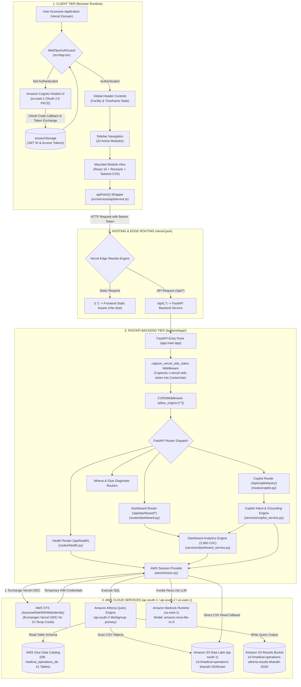

# Overall System Architecture

This diagram visualizes the complete multi-tier deployment of the Medical Operations Intelligence & Automation Command System across the browser, Vercel edge runtime, and AWS cloud services.

---

## 📋 Execution Summary

* **Frontend**: React 19 single-page application built with Vite (`src/main.tsx`, `src/App.tsx`).
* **Routing**: Managed by Vercel edge rewrites in [`vercel.json`](file:///D:/Development-of-Healthcare-Operations-Intelligence-Dashboard-with-Decision-Analytics/vercel.json), sending `/api/(.*)` to the Python backend and `/(.*)` to static Vite files.
* **Backend**: FastAPI running at [`backend/app/main.py`](file:///D:/Development-of-Healthcare-Operations-Intelligence-Dashboard-with-Decision-Analytics/backend/app/main.py) with request-scoped OIDC token capture middleware.
* **Workload Identity**: No static keys in production; [`backend/app/aws/session.py`](file:///D:/Development-of-Healthcare-Operations-Intelligence-Dashboard-with-Decision-Analytics/backend/app/aws/session.py) uses AWS STS `AssumeRoleWithWebIdentity` to exchange Vercel's identity token for 1-hour AWS credentials.
* **AWS Services**: Amazon Athena executes serverless SQL queries on Glue database `medical_operations_db` over S3, while Bedrock runs `amazon.nova-lite-v1:0` in `us-east-1`.
