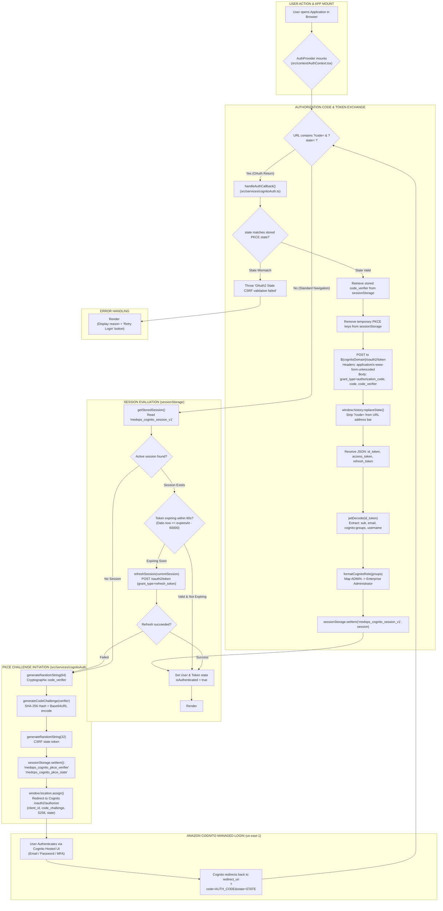

# Amazon Cognito OAuth 2.0 PKCE Authentication Flow

This diagram visualizes the browser-public Proof Key for Code Exchange (PKCE) flow implemented in `src/services/cognitoAuth.ts` and `src/context/AuthContext.tsx`.

---

## 📋 Execution Summary

* **Public Client Safety**: Browser single-page applications cannot safeguard client secrets; this implementation uses **PKCE (Proof Key for Code Exchange)** with SHA-256 (`S256`).
* **Session Storage Isolation**: Tokens are stored in browser `sessionStorage` under `medops_cognito_session_v1`, keeping sessions tab-isolated and protected against long-term `localStorage` XSS persistence.
* **URL Sanitization**: Authorization codes are purged from the browser address bar immediately via `window.history.replaceState()` to prevent shoulder-surfing and history leakage.
* **Silent Refresh**: Prior to expiration (60s buffer), `refreshSession()` quietly swaps the refresh token at `/oauth2/token` for a fresh session without interrupting the user.
* **Role Derivation**: Decodes the Cognito ID token claims (`cognito:groups`) using `jwt-decode` and maps groups (`ADMIN`, `DOCTOR`, `BILLING`) to formatted enterprise roles.
