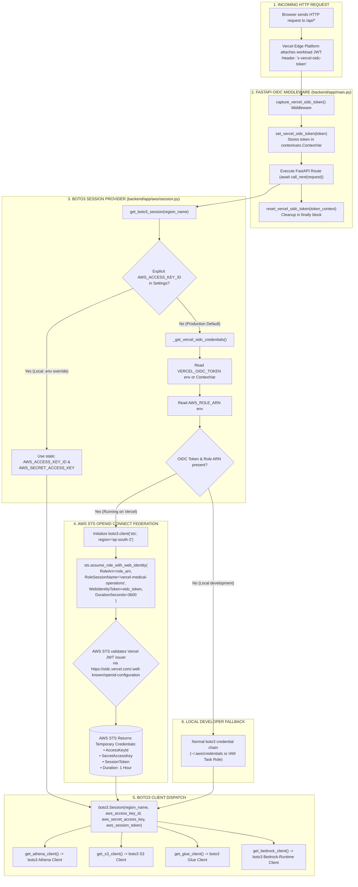

# Keyless Workload Identity Flow (Vercel OIDC -> AWS STS)

This diagram visualizes how the FastAPI backend securely communicates with AWS services without storing static IAM access keys in cloud environment variables.

---

## 📋 Execution Summary

* **Zero Static Secrets**: The cloud repository contains zero persistent AWS IAM access keys, eliminating credential leakage risks.
* **ContextVar Isolation**: The `capture_vercel_oidc_token` middleware uses Python's `contextvars.ContextVar` to safely isolate tokens per asynchronous request coroutine.
* **STS Web Identity Federation**: AWS STS validates Vercel's cryptographically signed JWT token against Vercel's OIDC discovery endpoint and assumes the specified IAM role.
* **Short-Lived Credentials**: Temporary credentials expire automatically after 3,600 seconds (1 hour).
* **Multi-Tier Fallback**: If OIDC is absent, `session.py` transparently falls back to local developer credentials (`~/.aws/credentials`).
