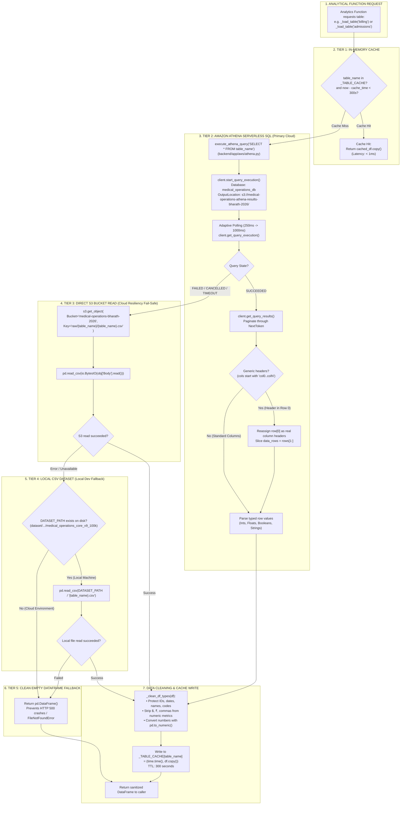

# Resilient 4-Tier Data Retrieval Hierarchy

This diagram visualizes the unified data retrieval pipeline implemented in `backend/app/services/dashboard_service.py` via `_load_table(table_name)`.

---

## 📋 Execution Summary

* **In-Memory Cache (Tier 1)**: Eliminates duplicate queries within 300 seconds, maintaining low dashboard latency.
* **Amazon Athena (Tier 2)**: Executes ANSI SQL queries against the AWS Glue Data Catalog (`medical_operations_db`), polling execution status with adaptive backoff.
* **Generic Column Auto-Fix**: Automatically detects and rectifies Glue table anomalies where headers were indexed as `col0`, `col1`, promoting the first row to header names.
* **Direct S3 Read (Tier 3)**: Bypasses Athena to stream CSV bytes directly from `s3://medical-operations-bharath-2026/raw/` if query workgroups encounter rate limits.
* **Local CSV (Tier 4)**: Enables complete offline development without active AWS credentials if the dataset directory is present.
* **Zero 500 Errors (Tier 5)**: Never throws `FileNotFoundError`; returns an empty DataFrame so the frontend displays a clean "No Records Found" state instead of crashing.
* **Protected Type Cleaning**: Prevents identifier corruption (e.g., `FAC001` or `claim_id`) by shielding protected column names while converting numeric currency values.
