# Executive Command Center Workflow

This diagram visualizes the complete execution flow of the **Executive Command Center** (`src/components/modules/ExecutiveCommandCenter.tsx`).

```mermaid
flowchart TD
    %% USER ACTION
    subgraph USER_ACTION["1. USER ACTION"]
        ClickExecutive["User clicks 'Executive Command Center' in Sidebar<br/>or selects Facility / Timeframe in Global Header"]
    end

    %% REACT FRONTEND
    subgraph REACT_FRONTEND["2. REACT FRONTEND (ExecutiveCommandCenter.tsx)"]
        MountComponent["Component mounts / updates<br/>selectedFacility: 'all' | 'FAC001'..'FAC005'<br/>selectedTimeframe: 'realtime' | 'today' | '7d' | '30d'"]
        SetLoading["setLoading(true), setError(null)"]
        ParallelFetch["Promise.all([<br/>  fetchExecutiveSummary(selectedFacility, selectedTimeframe),<br/>  fetchFacilityComparison(selectedTimeframe)<br/>])"]
    end

    %% API SERVICE
    subgraph API_SERVICE["3. API SERVICE LAYER (src/services/apiService.ts)"]
        ReqSummary["GET /api/dashboard/summary?facility_id={fac}&timeframe={tf}"]
        ReqComp["GET /api/dashboard/facilities-comparison?timeframe={tf}"]
        InjectAuth["apiFetch() injects Authorization: Bearer <cognito-token>"]
    end

    %% FASTAPI BACKEND
    subgraph FASTAPI_BACKEND["4. FASTAPI BACKEND (backend/app/routes/dashboard.py)"]
        RouteSummary["@router.get('/summary') -> get_summary()"]
        RouteComp["@router.get('/facilities-comparison') -> get_facilities_comp()"]
    end

    %% ANALYTICS ENGINE
    subgraph ANALYTICS_ENGINE["5. ANALYTICS ENGINE (backend/app/services/dashboard_service.py)"]
        ExecSummaryFunc["get_executive_summary(facility_id, timeframe)"]
        ExecCompFunc["get_facility_comparison(timeframe)"]
        
        LoadTables["_load_table() loads:<br/>• admissions.csv<br/>• billing.csv<br/>• claims.csv<br/>• emergency_visits.csv<br/>• facilities.csv"]
        
        ApplyFilters["_apply_date_filter() & facility_id filter"]
        
        CalcMetrics["Calculate Rollup Metrics:<br/>• totalAdmissions = len(df_adm)<br/>• avgLOS = _safe_mean(df_adm, 'length_of_stay_days')<br/>• totalRevenue = _safe_sum(df_bil, 'net_amount')<br/>• denialRate = (denied / totalClaims) * 100<br/>• avgEDWait = _safe_mean(df_ed, 'waiting_time_minutes')<br/>• occupancyRate = min(100, (admissions / 221) * 100)"]
        
        BuildKPIs["Construct 6 Executive KPI Objects:<br/>Target benchmarks, change %, positive/negative status"]
        
        BuildComp["Group by facility_id:<br/>Compute admissions, revenue, denialRate, occupancy per facility"]
    end

    %% AWS & DATA SOURCES
    subgraph AWS_DATA_SOURCES["6. AWS DATA LAYER"]
        CacheCheck{"_TABLE_CACHE hit?"}
        AthenaQuery["Amazon Athena Serverless SQL<br/>SELECT * FROM admissions, billing..."]
        S3Direct["Direct S3 Read Fallback<br/>s3://medical-operations-bharath-2026/raw/"]
    end

    %% RESPONSE & UI
    subgraph RESPONSE_AND_UI["7. JSON RESPONSE & FRONTEND RENDERING"]
        JSONPayload["HTTP 200 JSON Response:<br/>{ source, kpis: [...], rawMetrics: {...}, facilities: [...] }"]
        UpdateState["setSummaryData(res[0]), setComparisonData(res[1])<br/>setLoading(false)"]
        RenderCards["Render 6 Top-Level KPI Cards:<br/>• Total Admissions · Average LOS<br/>• Net Realized Revenue · Claim Denial Rate<br/>• ED Wait Time · Inpatient Bed Occupancy"]
        RenderCompTable["Render Cross-Facility Comparative Table:<br/>Facility ranking, health scores, and metrics"]
        DrilldownTrigger["User clicks facility row -> opens EnterpriseDrilldownModal"]
    end

    %% ERROR HANDLING
    subgraph ERROR_HANDLING["8. ERROR & FALLBACK HANDLING"]
        CatchError["Catch network / server error"]
        RenderError["Render AlertTriangle Error Banner with error message"]
        EmptyFallback["Zero values rendered safely if tables empty"]
    end

    %% CONNECTIONS
    ClickExecutive --> MountComponent
    MountComponent --> SetLoading
    SetLoading --> ParallelFetch
    ParallelFetch --> ReqSummary & ReqComp
    ReqSummary & ReqComp --> InjectAuth
    InjectAuth --> RouteSummary & RouteComp
    RouteSummary --> ExecSummaryFunc
    RouteComp --> ExecCompFunc
    ExecSummaryFunc & ExecCompFunc --> LoadTables
    LoadTables --> CacheCheck
    CacheCheck -- "Miss" --> AthenaQuery
    AthenaQuery -- "Fail" --> S3Direct
    AthenaQuery -- "Success" --> ApplyFilters
    S3Direct --> ApplyFilters
    CacheCheck -- "Hit" --> ApplyFilters

    ApplyFilters --> CalcMetrics --> BuildKPIs & BuildComp
    BuildKPIs & BuildComp --> JSONPayload
    JSONPayload --> UpdateState
    UpdateState --> RenderCards & RenderCompTable
    RenderCompTable --> DrilldownTrigger

    ParallelFetch -. "Network Failure" .-> CatchError --> RenderError
    LoadTables -. "Missing Tables" .-> EmptyFallback
```

---

## 📋 Execution Summary

* **Frontend Component**: [`src/components/modules/ExecutiveCommandCenter.tsx`](file:///D:/Development-of-Healthcare-Operations-Intelligence-Dashboard-with-Decision-Analytics/src/components/modules/ExecutiveCommandCenter.tsx).
* **API Endpoints**: `GET /api/dashboard/summary` and `GET /api/dashboard/facilities-comparison`.
* **Backend Handlers**: `get_executive_summary()` and `get_facility_comparison()` in [`backend/app/services/dashboard_service.py`](file:///D:/Development-of-Healthcare-Operations-Intelligence-Dashboard-with-Decision-Analytics/backend/app/services/dashboard_service.py#L322-L460).
* **Primary Tables**: `admissions`, `billing`, `claims`, `emergency_visits`, `facilities`.
* **Output Metrics**: Total Admissions, Average LOS, Net Revenue, Denial Rate, Average ED Wait, Bed Occupancy Rate, and 5-facility comparative matrix.
