# Patient Operations Workflow

This diagram visualizes the complete execution flow of the **Patient Operations** module (`src/components/modules/PatientOperations.tsx`).

```mermaid
flowchart TD
    %% USER ACTION
    subgraph USER_ACTION["1. USER ACTION"]
        UserNav["User clicks 'Patient Operations' in Sidebar<br/>or alters Facility / Timeframe filters"]
    end

    %% REACT FRONTEND
    subgraph REACT_FRONTEND["2. REACT FRONTEND (PatientOperations.tsx)"]
        MountComp["Component mounts / updates<br/>State: data, loading, error<br/>Props: selectedFacility, selectedTimeframe"]
        SetLoading["setLoading(true), setError(null)"]
        FetchCall["fetchPatientOpsIntelligence(selectedFacility, selectedTimeframe)"]
    end

    %% API SERVICE
    subgraph API_SERVICE["3. API SERVICE (src/services/apiService.ts)"]
        APICall["GET /api/dashboard/patient-ops?facility_id={fac}&timeframe={tf}"]
        TokenWrapper["apiFetch() attaches Cognito Bearer Token"]
    end

    %% FASTAPI BACKEND
    subgraph FASTAPI_BACKEND["4. FASTAPI ROUTE (backend/app/routes/dashboard.py)"]
        RoutePatientOps["@router.get('/patient-ops')<br/>get_patient_ops(facility_id, timeframe, start_date, end_date)"]
    end

    %% ANALYTICS ENGINE
    subgraph ANALYTICS_ENGINE["5. ANALYTICS ENGINE (backend/app/services/dashboard_service.py)"]
        ServiceFunc["get_patient_ops_intelligence(facility_id, timeframe)"]
        LoadTables["_load_table() loads:<br/>• admissions.csv<br/>• patients.csv<br/>• emergency_visits.csv"]
        FilterData["Filter by facility_id and admission_date / arrival_datetime"]
        CalcStats["Calculate Patient Flow Metrics:<br/>• totalAdmissions = len(df_adm)<br/>• avgLOS = _safe_mean(df_adm, 'length_of_stay_days')<br/>• emergencyVisits = len(df_ed)<br/>• avgEDWait = _safe_mean(df_ed, 'waiting_time_minutes')<br/>• admissionTypes = df_adm['admission_type'].value_counts()<br/>• genderDemographics = df_pat['gender'].value_counts()<br/>• monthlyAdmissions = Group by Month of admission_date"]
        BuildJSON["Return structured Dictionary with metrics and chart series"]
    end

    %% AWS & DATA SOURCES
    subgraph AWS_DATA_SOURCES["6. AWS DATA LAYER"]
        Cache{"In-Memory Cache (300s TTL)"}
        AthenaQuery["Amazon Athena Serverless SQL<br/>SELECT * FROM admissions, patients, emergency_visits"]
        S3Fallback["Direct S3 Read Fallback<br/>s3://medical-operations-bharath-2026/raw/"]
    end

    %% RESPONSE & UI
    subgraph RESPONSE_AND_UI["7. JSON RESPONSE & FRONTEND RENDERING"]
        JSONRes["HTTP 200 JSON Response:<br/>{ totalAdmissions, avgLengthOfStay, emergencyVisits,<br/>  avgEDWaitTime, admissionTypes, demographics, monthlyAdmissions }"]
        UpdateState["setData(res), setLoading(false)"]
        RenderCards["Render 4 Top Metric Cards:<br/>• Inpatient Admissions (e.g. 1,420)<br/>• Average Length of Stay (LOS, e.g. 4.8 Days)<br/>• Total Emergency Encounters (e.g. 2,140)<br/>• Average ED Wait Time (e.g. 28.4 mins)"]
        RenderCharts["Render Recharts Visualizations:<br/>• <AreaChart>: Monthly Inpatient Admissions Trend<br/>• <BarChart>: Admission Type Breakdown (Emergency, Elective, Urgent)<br/>• <PieChart>: Patient Demographics by Gender & Age Group"]
    end

    %% ERROR & FALLBACK
    subgraph ERROR_HANDLING["8. ERROR & FALLBACK HANDLING"]
        CatchErr["Catch network error -> setError(err.message)"]
        RenderErr["Render AlertTriangle Error Notice"]
        NoRecords["Render 'No Patient Records Found' if admissions == 0"]
    end

    %% CONNECTIONS
    UserNav --> MountComp
    MountComp --> SetLoading
    SetLoading --> FetchCall
    FetchCall --> APICall
    APICall --> TokenWrapper
    TokenWrapper --> RoutePatientOps
    RoutePatientOps --> ServiceFunc
    ServiceFunc --> LoadTables
    LoadTables --> Cache
    Cache -- "Miss" --> AthenaQuery
    AthenaQuery -- "Fail" --> S3Fallback
    AthenaQuery -- "Success" --> FilterData
    S3Fallback --> FilterData
    Cache -- "Hit" --> FilterData

    FilterData --> CalcStats
    CalcStats --> BuildJSON
    BuildJSON --> JSONRes
    JSONRes --> UpdateState
    UpdateState --> RenderCards & RenderCharts

    FetchCall -. "Fetch Exception" .-> CatchErr --> RenderErr
    BuildJSON -. "Empty DataFrame" .-> NoRecords
```

---

## 📋 Execution Summary

* **Frontend Component**: [`src/components/modules/PatientOperations.tsx`](file:///D:/Development-of-Healthcare-Operations-Intelligence-Dashboard-with-Decision-Analytics/src/components/modules/PatientOperations.tsx).
* **API Endpoint**: `GET /api/dashboard/patient-ops?facility_id={fac}&timeframe={tf}`.
* **Backend Handler**: `get_patient_ops_intelligence()` in [`backend/app/services/dashboard_service.py`](file:///D:/Development-of-Healthcare-Operations-Intelligence-Dashboard-with-Decision-Analytics/backend/app/services/dashboard_service.py#L725-L815).
* **Primary Tables**: `admissions`, `patients`, `emergency_visits`.
* **Output Metrics**: Total Admissions, Average Length of Stay (days), Emergency Visits count, Average ED Wait (minutes), Admission Types breakdown, and Demographics.
