# Doctor & Staff Intelligence Workflow

This diagram visualizes the complete execution flow of the **Doctor & Staff Intelligence** module (`src/components/modules/DoctorStaffIntelligence.tsx`).

```mermaid
flowchart TD
    %% USER ACTION
    subgraph USER_ACTION["1. USER ACTION"]
        UserNav["User selects 'Doctor & Staff Intelligence' in Sidebar"]
    end

    %% REACT FRONTEND
    subgraph REACT_FRONTEND["2. REACT FRONTEND (DoctorStaffIntelligence.tsx)"]
        Mount["Component mounts with selectedFacility, selectedTimeframe"]
        StartLoading["setLoading(true), setError(null)"]
        CallAPI["fetchDoctorStaffIntelligence(selectedFacility, selectedTimeframe)"]
    end

    %% API SERVICE
    subgraph API_SERVICE["3. API SERVICE (src/services/apiService.ts)"]
        APIFetch["GET /api/dashboard/doctor-staff?facility_id={fac}&timeframe={tf}"]
        AuthToken["Attach Authorization: Bearer <token>"]
    end

    %% FASTAPI BACKEND
    subgraph FASTAPI_BACKEND["4. FASTAPI ROUTE (backend/app/routes/dashboard.py)"]
        RouteDoctorStaff["@router.get('/doctor-staff')<br/>get_doctor_staff(facility_id, timeframe, ...)"]
    end

    %% ANALYTICS ENGINE
    subgraph ANALYTICS_ENGINE["5. ANALYTICS ENGINE (backend/app/services/dashboard_service.py)"]
        ServiceFunc["get_doctor_staff_intelligence(facility_id, timeframe)"]
        LoadData["_load_table() loads:<br/>• doctor_workload.csv<br/>• doctors.csv<br/>• departments.csv"]
        Filter["Filter by facility_id"]
        TypeConversion["_clean_df_types() casts:<br/>working_hours, overtime_hours, appointments_handled, surgeries_performed"]
        Compute["Compute Workload KPIs:<br/>• activeDoctorsCount = len(df_doc)<br/>• avgDoctorUtilization = _safe_mean(df_dw, 'utilization_pct')<br/>• totalWorkingHours = _safe_sum(df_dw, 'working_hours')<br/>• overtimeHours = _safe_sum(df_dw, 'overtime_hours')<br/>• topDoctors: Merge doctors with workload, sort by surgeries/appointments<br/>• departmentUtilization: Group by department_name"]
    end

    %% AWS & DATA SOURCES
    subgraph AWS_DATA_SOURCES["6. AWS DATA LAYER"]
        Cache{"_TABLE_CACHE Hit?"}
        AthenaQuery["Amazon Athena Serverless SQL<br/>SELECT * FROM doctor_workload, doctors"]
        S3Direct["Direct S3 Read Fallback<br/>s3://medical-operations-bharath-2026/raw/"]
    end

    %% RESPONSE & UI
    subgraph RESPONSE_AND_UI["7. JSON RESPONSE & FRONTEND RENDERING"]
        JSONRes["HTTP 200 JSON Response:<br/>{ activeDoctorsCount, avgDoctorUtilization, totalWorkingHours,<br/>  overtimeHours, topDoctors: [...], departmentUtilization: [...] }"]
        UpdateState["setData(res), setLoading(false)"]
        RenderCards["Render Workload KPI Cards:<br/>• Active Physician Roster Count<br/>• Clinical Capacity Utilization % (e.g. 74.2%)<br/>• Total Workload Hours Logged<br/>• Overtime Load Ratio (Overtime / Total Hours %)"]
        RenderCharts["Render Workload Visualizations:<br/>• <BarChart>: Utilization % by Medical Department<br/>• Top Physician Roster Table (Appointments, Surgeries, Overtime)<br/>• Shift Fatigue Risk Indicators"]
    end

    %% ERROR & FALLBACK
    subgraph ERROR_HANDLING["8. ERROR & FALLBACK HANDLING"]
        CatchErr["Catch network exception -> setError(err.message)"]
        RenderErrorScreen["Render Error Alert Screen with retry option"]
    end

    %% CONNECTIONS
    UserNav --> Mount
    Mount --> StartLoading
    StartLoading --> CallAPI
    CallAPI --> APIFetch
    APIFetch --> AuthToken
    AuthToken --> RouteDoctorStaff
    RouteDoctorStaff --> ServiceFunc
    ServiceFunc --> LoadData
    LoadData --> Cache
    Cache -- "Miss" --> AthenaQuery
    AthenaQuery -- "Fail" --> S3Direct
    AthenaQuery -- "Success" --> Filter
    S3Direct --> Filter
    Cache -- "Hit" --> Filter

    Filter --> TypeConversion
    TypeConversion --> Compute
    Compute --> JSONRes
    JSONRes --> UpdateState
    UpdateState --> RenderCards & RenderCharts

    CallAPI -. "Network Error" .-> CatchErr --> RenderErrorScreen
```

---

## 📋 Execution Summary

* **Frontend Component**: [`src/components/modules/DoctorStaffIntelligence.tsx`](file:///D:/Development-of-Healthcare-Operations-Intelligence-Dashboard-with-Decision-Analytics/src/components/modules/DoctorStaffIntelligence.tsx).
* **API Endpoint**: `GET /api/dashboard/doctor-staff?facility_id={fac}&timeframe={tf}`.
* **Backend Handler**: `get_doctor_staff_intelligence()` in [`backend/app/services/dashboard_service.py`](file:///D:/Development-of-Healthcare-Operations-Intelligence-Dashboard-with-Decision-Analytics/backend/app/services/dashboard_service.py#L817-L910).
* **Primary Tables**: `doctor_workload`, `doctors`, `departments`.
* **Output Metrics**: Active Doctors count, Average Utilization %, Total Working Hours, Overtime Hours, Department Utilization breakdown, and Top Doctors list.
