# Emergency & Critical Operations Workflow

This diagram visualizes the complete execution flow of the **Emergency & Critical Operations** module (`src/components/modules/EmergencyCriticalOperations.tsx`).

```mermaid
flowchart TD
    %% USER ACTION
    subgraph USER_ACTION["1. USER ACTION"]
        UserNav["User clicks 'Emergency & Critical Ops' in Sidebar"]
    end

    %% REACT FRONTEND
    subgraph REACT_FRONTEND["2. REACT FRONTEND (EmergencyCriticalOperations.tsx)"]
        Mount["Component mounts with selectedFacility, selectedTimeframe"]
        SetLoading["setLoading(true), setError(null)"]
        FetchCall["fetchEmergencyCriticalIntelligence(selectedFacility, selectedTimeframe)"]
    end

    %% API SERVICE
    subgraph API_SERVICE["3. API SERVICE (src/services/apiService.ts)"]
        CallAPI["GET /api/dashboard/emergency-critical?facility_id={fac}&timeframe={tf}"]
        AttachToken["apiFetch() injects Bearer Token"]
    end

    %% FASTAPI BACKEND
    subgraph FASTAPI_BACKEND["4. FASTAPI ROUTE (backend/app/routes/dashboard.py)"]
        RouteEmergency["@router.get('/emergency-critical')<br/>get_emergency_critical(facility_id, timeframe, ...)"]
    end

    %% ANALYTICS ENGINE
    subgraph ANALYTICS_ENGINE["5. ANALYTICS ENGINE (backend/app/services/dashboard_service.py)"]
        ServiceFunc["get_emergency_critical_intelligence(facility_id, timeframe)"]
        LoadData["_load_table() loads:<br/>• emergency_visits.csv<br/>• icu_stays.csv<br/>• departments.csv"]
        Filter["Filter by facility_id and arrival_datetime"]
        CalcEmergency["Compute Emergency & ICU Telemetry:<br/>• totalVisits = len(df_ed)<br/>• avgWaitTime = _safe_mean(df_ed, 'waiting_time_minutes')<br/>• doorToDoctorTime = _safe_mean(df_ed, 'treatment_duration_minutes')<br/>• icuTransfers = len(df_icu)<br/>• triageDistribution: Count by triage_level (Level 1 Resuscitation -> Level 5 Non-urgent)<br/>• dispositionBreakdown: Admitted vs Discharged vs Transferred<br/>• hourlyArrivalPattern: Group by arrival hour (0..23)"]
    end

    %% AWS DATA LAYER
    subgraph AWS_DATA_SOURCES["6. AWS DATA LAYER"]
        Cache{"_TABLE_CACHE Hit?"}
        AthenaQuery["Amazon Athena Serverless SQL<br/>SELECT * FROM emergency_visits, icu_stays"]
        S3Direct["Direct S3 Read Fallback<br/>s3://medical-operations-bharath-2026/raw/"]
    end

    %% RESPONSE & UI
    subgraph RESPONSE_AND_UI["7. JSON RESPONSE & FRONTEND RENDERING"]
        JSONRes["HTTP 200 JSON Response:<br/>{ totalVisits, avgWaitTime, doorToDoctorTime, icuTransfers,<br/>  triageLevels: [...], dispositions: [...], hourlySurge: [...] }"]
        UpdateState["setData(res), setLoading(false)"]
        RenderCards["Render Emergency KPI Cards:<br/>• Total ED Encounters · Door-to-Doctor Wait (mins)<br/>• High-Acuity Resuscitation Ratio · Active ICU Stays"]
        RenderCharts["Render Critical Care Visualizations:<br/>• <BarChart>: Triage Acuity Distribution (ESI Levels 1-5)<br/>• <AreaChart>: 24-Hour Emergency Surge & Arrival Curve<br/>• Patient Disposition Breakdown (Admitted to Ward, Discharged, ICU)"]
    end

    %% ERROR & FALLBACK
    subgraph ERROR_HANDLING["8. ERROR & FALLBACK HANDLING"]
        CatchErr["Catch API error -> setError(err.message)"]
        ShowError["Render Emergency Analytics Error Screen"]
    end

    %% CONNECTIONS
    UserNav --> Mount
    Mount --> SetLoading
    SetLoading --> FetchCall
    FetchCall --> CallAPI
    CallAPI --> AttachToken
    AttachToken --> RouteEmergency
    RouteEmergency --> ServiceFunc
    ServiceFunc --> LoadData
    LoadData --> Cache
    Cache -- "Miss" --> AthenaQuery
    AthenaQuery -- "Fail" --> S3Direct
    AthenaQuery -- "Success" --> Filter
    S3Direct --> Filter
    Cache -- "Hit" --> Filter

    Filter --> CalcEmergency
    CalcEmergency --> JSONRes
    JSONRes --> UpdateState
    UpdateState --> RenderCards & RenderCharts

    FetchCall -. "Fetch Failure" .-> CatchErr --> ShowError
```

---

## 📋 Execution Summary

* **Frontend Component**: [`src/components/modules/EmergencyCriticalOperations.tsx`](file:///D:/Development-of-Healthcare-Operations-Intelligence-Dashboard-with-Decision-Analytics/src/components/modules/EmergencyCriticalOperations.tsx).
* **API Endpoint**: `GET /api/dashboard/emergency-critical?facility_id={fac}&timeframe={tf}`.
* **Backend Handler**: `get_emergency_critical_intelligence()` in [`backend/app/services/dashboard_service.py`](file:///D:/Development-of-Healthcare-Operations-Intelligence-Dashboard-with-Decision-Analytics/backend/app/services/dashboard_service.py#L2650-L2780).
* **Primary Tables**: `emergency_visits`, `icu_stays`, `departments`.
* **Output Metrics**: Total ED Encounters, Average Waiting Time (mins), Door-to-Doctor duration, Triage Acuity Levels (ESI 1-5), ICU transfers, and 24-hour surge distribution.
