# Billing & Revenue Intelligence Workflow

This diagram visualizes the complete execution flow of the **Billing & Revenue Intelligence** module (`src/components/modules/BillingRevenueIntelligence.tsx`).

```mermaid
flowchart TD
    %% USER ACTION
    subgraph USER_ACTION["1. USER ACTION"]
        UserNav["User clicks 'Billing & Revenue Intelligence' in Sidebar"]
    end

    %% REACT FRONTEND
    subgraph REACT_FRONTEND["2. REACT FRONTEND (BillingRevenueIntelligence.tsx)"]
        Mount["Component mounts / updates<br/>State: data, loading, error<br/>Props: selectedFacility, selectedTimeframe"]
        SetLoading["setLoading(true), setError(null)"]
        CallAPI["fetchBillingIntelligence(selectedFacility, selectedTimeframe)"]
    end

    %% API SERVICE
    subgraph API_SERVICE["3. API SERVICE LAYER (src/services/apiService.ts)"]
        Req["GET /api/dashboard/billing?facility_id={fac}&timeframe={tf}"]
        Auth["apiFetch() injects Authorization: Bearer <token>"]
    end

    %% FASTAPI BACKEND
    subgraph FASTAPI_BACKEND["4. FASTAPI ROUTE (backend/app/routes/dashboard.py)"]
        RouteBilling["@router.get('/billing')<br/>get_billing(facility_id, timeframe, ...)"]
    end

    %% ANALYTICS ENGINE
    subgraph ANALYTICS_ENGINE["5. ANALYTICS ENGINE (backend/app/services/dashboard_service.py)"]
        ServiceFunc["get_billing_intelligence(facility_id, timeframe)"]
        LoadData["_load_table() loads:<br/>• billing.csv<br/>• departments.csv"]
        Filter["Filter by facility_id and bill_date"]
        CleanTypes["_to_num() cleans numeric series:<br/>net_amount, gross_amount, insurance_amount,<br/>patient_amount, outstanding_amount"]
        ComputeRevenue["Calculate Revenue Metrics:<br/>• grossRevenue = _safe_sum(df_bil, 'gross_amount')<br/>• totalRevenue = _safe_sum(df_bil, 'net_amount')<br/>• outstandingAR = _safe_sum(df_bil, 'outstanding_amount')<br/>• insuranceAmount = _safe_sum(df_bil, 'insurance_amount')<br/>• patientAmount = _safe_sum(df_bil, 'patient_amount')<br/>• departmentRevenue: Inner merge with departments on department_id,<br/>  groupby('department_name')['net_amount'].sum()<br/>• payerMix: groupby('payment_method')['net_amount'].sum()<br/>• monthlyRevenue: Group by Month of bill_date (last 12 months)"]
    end

    %% AWS DATA LAYER
    subgraph AWS_DATA_SOURCES["6. AWS DATA LAYER"]
        Cache{"_TABLE_CACHE Hit?"}
        AthenaQuery["Amazon Athena Serverless SQL<br/>SELECT * FROM billing, departments"]
        S3Direct["Direct S3 Read Fallback<br/>s3://medical-operations-bharath-2026/raw/"]
    end

    %% RESPONSE & UI
    subgraph RESPONSE_AND_UI["7. JSON RESPONSE & FRONTEND RENDERING"]
        JSONRes["HTTP 200 JSON Response:<br/>{ totalRevenue, grossRevenue, outstandingAR,<br/>  insuranceAmount, patientAmount, departmentRevenue, payerMix, monthlyRevenue }"]
        UpdateState["setData(res), setLoading(false)"]
        RenderCards["Render Top Financial Stat Cards:<br/>• Gross Billed Revenue: ₹{(grossRevenue / 1e6).toFixed(2)} M<br/>• Net Revenue Collected: ₹{(totalRevenue / 1e6).toFixed(2)} M<br/>• Outstanding Accounts Receivable: ₹{(outstandingAR / 1e6).toFixed(2)} M<br/>• Revenue Realization Rate: (totalRevenue / grossRevenue * 100)%"]
        RenderCharts["Render Financial Visualizations:<br/>• <BarChart>: Revenue Contribution by Medical Department (₹M)<br/>• <PieChart>: Payer Mix Breakdown (Insurance, Cash, Government)<br/>• 12-Month Invoiced vs Collected Collections Trend"]
    end

    %% ERROR & FALLBACK
    subgraph ERROR_HANDLING["8. ERROR & FALLBACK HANDLING"]
        CatchErr["Catch network error -> setError(err.message)"]
        ShowErr["Render Billing Analytics API Error Box"]
        ZeroData["Render 'No Billing Records Found' if revenue == 0"]
    end

    %% CONNECTIONS
    UserNav --> Mount
    Mount --> SetLoading
    SetLoading --> CallAPI
    CallAPI --> Req
    Req --> Auth
    Auth --> RouteBilling
    RouteBilling --> ServiceFunc
    ServiceFunc --> LoadData
    LoadData --> Cache
    Cache -- "Miss" --> AthenaQuery
    AthenaQuery -- "Fail" --> S3Direct
    AthenaQuery -- "Success" --> Filter
    S3Direct --> Filter
    Cache -- "Hit" --> Filter

    Filter --> CleanTypes
    CleanTypes --> ComputeRevenue
    ComputeRevenue --> JSONRes
    JSONRes --> UpdateState
    UpdateState --> RenderCards & RenderCharts

    CallAPI -. "Network Error" .-> CatchErr --> ShowErr
    ComputeRevenue -. "Empty Data" .-> ZeroData
```

---

## 📋 Execution Summary

* **Frontend Component**: [`src/components/modules/BillingRevenueIntelligence.tsx`](file:///D:/Development-of-Healthcare-Operations-Intelligence-Dashboard-with-Decision-Analytics/src/components/modules/BillingRevenueIntelligence.tsx).
* **API Endpoint**: `GET /api/dashboard/billing?facility_id={fac}&timeframe={tf}`.
* **Backend Handler**: `get_billing_intelligence()` in [`backend/app/services/dashboard_service.py`](file:///D:/Development-of-Healthcare-Operations-Intelligence-Dashboard-with-Decision-Analytics/backend/app/services/dashboard_service.py#L604-L665).
* **Primary Tables**: `billing`, `departments`.
* **Output Metrics**: Gross Billed Revenue, Net Revenue Collected, Outstanding A/R, Insurance Payouts, Patient Payouts, Department Revenue contribution, and Payer Mix.
