# Insurance Claims Automation Workflow

This diagram visualizes the complete execution flow of the **Insurance & Claims Automation** module (`src/components/modules/InsuranceClaimsAutomation.tsx`).

```mermaid
flowchart TD
    %% USER ACTION
    subgraph USER_ACTION["1. USER ACTION"]
        UserNav["User clicks 'Insurance & Claims Automation' in Sidebar"]
    end

    %% REACT FRONTEND
    subgraph REACT_FRONTEND["2. REACT FRONTEND (InsuranceClaimsAutomation.tsx)"]
        Mount["Component mounts with selectedFacility, selectedTimeframe"]
        SetLoading["setLoading(true), setError(null)"]
        CallAPI["fetchClaimsIntelligence(selectedFacility, selectedTimeframe)"]
    end

    %% API SERVICE
    subgraph API_SERVICE["3. API SERVICE (src/services/apiService.ts)"]
        APIFetch["GET /api/dashboard/claims?facility_id={fac}&timeframe={tf}"]
        Auth["Attach Authorization: Bearer <token>"]
    end

    %% FASTAPI BACKEND
    subgraph FASTAPI_BACKEND["4. FASTAPI ROUTE (backend/app/routes/dashboard.py)"]
        RouteClaims["@router.get('/claims')<br/>get_claims(facility_id, timeframe, ...)"]
    end

    %% ANALYTICS ENGINE
    subgraph ANALYTICS_ENGINE["5. ANALYTICS ENGINE (backend/app/services/dashboard_service.py)"]
        ServiceFunc["get_claims_intelligence(facility_id, timeframe)"]
        LoadData["_load_table('claims')"]
        Filter["Filter by facility_id and submission_date"]
        CleanTypes["_to_num(df_clm['claimed_amount'])"]
        CalculateDenials["Compute Claims & Denial Intelligence:<br/>• totalClaims = len(df_clm)<br/>• denied = df_clm[df_clm['claim_status'] == 'Denied']<br/>• deniedClaims = len(denied)<br/>• denialRate = (deniedClaims / totalClaims) * 100<br/>• claimedAmount = _safe_sum(df_clm, 'claimed_amount')<br/>• deniedAmount = _safe_sum(denied, 'claimed_amount')<br/>• statusBreakdown: df_clm['claim_status'].value_counts()<br/>• denialReasons: denied['denial_reason'].value_counts().head(10)<br/>• payers: Group by 'payer', agg totalClaims, claimedAmount, denialRate"]
    end

    %% AWS DATA LAYER
    subgraph AWS_DATA_SOURCES["6. AWS DATA LAYER"]
        Cache{"_TABLE_CACHE Hit?"}
        AthenaQuery["Amazon Athena Serverless SQL<br/>SELECT * FROM claims"]
        S3Direct["Direct S3 Read Fallback<br/>s3://medical-operations-bharath-2026/raw/claims/"]
    end

    %% RESPONSE & UI
    subgraph RESPONSE_AND_UI["7. JSON RESPONSE & FRONTEND RENDERING"]
        JSONRes["HTTP 200 JSON Response:<br/>{ totalClaims, deniedClaims, denialRate, claimedAmount,<br/>  deniedAmount, statusBreakdown, denialReasons, payers }"]
        UpdateState["setData(res), setLoading(false)"]
        RenderCards["Render Claims KPI Cards:<br/>• Overall Claim Denial Rate (e.g. 9.4%)<br/>• Total Denied Claims Count · Denied Revenue Exposure (₹M)<br/>• Clean Claims Adjudication Rate"]
        RenderCharts["Render Claims Visualizations:<br/>• <PieChart>: Claim Adjudication Status (Approved, Denied, Pending)<br/>• <BarChart>: Top Denial Reasons Pareto (Missing Prior-Auth, Coding Mismatch)<br/>• Commercial vs Government Payer Denial Risk Scorecard"]
    end

    %% ERROR & FALLBACK
    subgraph ERROR_HANDLING["8. ERROR & FALLBACK HANDLING"]
        CatchErr["Catch API error -> setError(err.message)"]
        ShowError["Render Claims Analytics Error Notice"]
    end

    %% CONNECTIONS
    UserNav --> Mount
    Mount --> SetLoading
    SetLoading --> CallAPI
    CallAPI --> APIFetch
    APIFetch --> Auth
    Auth --> RouteClaims
    RouteClaims --> ServiceFunc
    ServiceFunc --> LoadData
    LoadData --> Cache
    Cache -- "Miss" --> AthenaQuery
    AthenaQuery -- "Fail" --> S3Direct
    AthenaQuery -- "Success" --> Filter
    S3Direct --> Filter
    Cache -- "Hit" --> Filter

    Filter --> CleanTypes
    CleanTypes --> CalculateDenials
    CalculateDenials --> JSONRes
    JSONRes --> UpdateState
    UpdateState --> RenderCards & RenderCharts

    CallAPI -. "Network Error" .-> CatchErr --> ShowError
```

---

## 📋 Execution Summary

* **Frontend Component**: [`src/components/modules/InsuranceClaimsAutomation.tsx`](file:///D:/Development-of-Healthcare-Operations-Intelligence-Dashboard-with-Decision-Analytics/src/components/modules/InsuranceClaimsAutomation.tsx).
* **API Endpoint**: `GET /api/dashboard/claims?facility_id={fac}&timeframe={tf}`.
* **Backend Handler**: `get_claims_intelligence()` in [`backend/app/services/dashboard_service.py`](file:///D:/Development-of-Healthcare-Operations-Intelligence-Dashboard-with-Decision-Analytics/backend/app/services/dashboard_service.py#L667-L723).
* **Primary Table**: `claims`.
* **Output Metrics**: Total Claims, Denied Claims, Denial Rate %, Total Claimed Amount, Denied Amount Exposure, Status Breakdown, Denial Reasons Pareto, and Payer-specific Denial Rates.
