# Medical Coding & Documentation Workflow

This diagram visualizes the complete execution flow of the **Medical Coding & Documentation** module (`src/components/modules/MedicalCodingDocumentation.tsx`).

```mermaid
flowchart TD
    %% USER ACTION
    subgraph USER_ACTION["1. USER ACTION"]
        UserNav["User selects 'Medical Coding & Documentation' in Sidebar"]
    end

    %% REACT FRONTEND
    subgraph REACT_FRONTEND["2. REACT FRONTEND (MedicalCodingDocumentation.tsx)"]
        Mount["Component mounts with selectedFacility, selectedTimeframe"]
        SetLoading["setLoading(true), setError(null)"]
        CallAPI["fetchMedicalCodingIntelligence(selectedFacility, selectedTimeframe)"]
    end

    %% API SERVICE
    subgraph API_SERVICE["3. API SERVICE (src/services/apiService.ts)"]
        Req["GET /api/dashboard/medical-coding?facility_id={fac}&timeframe={tf}"]
        Auth["apiFetch() injects Bearer Token"]
    end

    %% FASTAPI BACKEND
    subgraph FASTAPI_BACKEND["4. FASTAPI ROUTE (backend/app/routes/dashboard.py)"]
        RouteCoding["@router.get('/medical-coding')<br/>get_medical_coding(facility_id, timeframe, ...)"]
    end

    %% ANALYTICS ENGINE
    subgraph ANALYTICS_ENGINE["5. ANALYTICS ENGINE (backend/app/services/dashboard_service.py)"]
        ServiceFunc["get_medical_coding_intelligence(facility_id, timeframe)"]
        LoadData["_load_table() loads:<br/>• admissions.csv<br/>• discharge_records.csv<br/>• billing.csv"]
        Filter["Filter by facility_id and discharge_date"]
        CalcCoding["Calculate Coding Velocity & Integrity:<br/>• unbilledDischarges: discharges without matching bill_id<br/>• avgCodingLagDays: discharge_date -> bill_date delta (e.g. 2.6 days)<br/>• topDRGCategories: Group by diagnosis / DRG code<br/>• codingAccuracyScore: Proportion of claims without coding-related denials<br/>• documentationDeficiencyRate: Missing summary or incomplete records %"]
    end

    %% AWS DATA LAYER
    subgraph AWS_DATA_SOURCES["6. AWS DATA LAYER"]
        Cache{"_TABLE_CACHE Hit?"}
        AthenaQuery["Amazon Athena Serverless SQL<br/>SELECT * FROM admissions, discharge_records, billing"]
        S3Direct["Direct S3 Read Fallback<br/>s3://medical-operations-bharath-2026/raw/"]
    end

    %% RESPONSE & UI
    subgraph RESPONSE_AND_UI["7. JSON RESPONSE & FRONTEND RENDERING"]
        JSONRes["HTTP 200 JSON Response:<br/>{ unbilledCount, avgCodingLagDays, codingAccuracyScore,<br/>  documentationDeficiencyRate, drgBreakdown: [...], coderProductivity: [...] }"]
        UpdateState["setData(res), setLoading(false)"]
        RenderCards["Render Medical Coding Stat Cards:<br/>• Average Coding Lag: 2.6 Days<br/>• Unbilled Discharged Records Count<br/>• Clean Coding Adjudication Index (e.g. 96.2%)<br/>• High-Risk Documentation Deficiencies"]
        RenderCharts["Render Coding Visualizations:<br/>• <BarChart>: Top 10 Clinical DRG / ICD-10 Diagnostic Groups<br/>• Discharge-to-Bill Turnaround Timeline Curve<br/>• Coder Audit Discrepancy & Query Rate Log"]
    end

    %% ERROR & FALLBACK
    subgraph ERROR_HANDLING["8. ERROR & FALLBACK HANDLING"]
        CatchErr["Catch API error -> setError(err.message)"]
        ShowError["Render Medical Coding Analytics Error Notice"]
    end

    %% CONNECTIONS
    UserNav --> Mount
    Mount --> SetLoading
    SetLoading --> CallAPI
    CallAPI --> Req
    Req --> Auth
    Auth --> RouteCoding
    RouteCoding --> ServiceFunc
    ServiceFunc --> LoadData
    LoadData --> Cache
    Cache -- "Miss" --> AthenaQuery
    AthenaQuery -- "Fail" --> S3Direct
    AthenaQuery -- "Success" --> Filter
    S3Direct --> Filter
    Cache -- "Hit" --> Filter

    Filter --> CalcCoding
    CalcCoding --> JSONRes
    JSONRes --> UpdateState
    UpdateState --> RenderCards & RenderCharts

    CallAPI -. "Network Error" .-> CatchErr --> ShowError
```

---

## 📋 Execution Summary

* **Frontend Component**: [`src/components/modules/MedicalCodingDocumentation.tsx`](file:///D:/Development-of-Healthcare-Operations-Intelligence-Dashboard-with-Decision-Analytics/src/components/modules/MedicalCodingDocumentation.tsx).
* **API Endpoint**: `GET /api/dashboard/medical-coding?facility_id={fac}&timeframe={tf}`.
* **Backend Handler**: `get_medical_coding_intelligence()` in [`backend/app/services/dashboard_service.py`](file:///D:/Development-of-Healthcare-Operations-Intelligence-Dashboard-with-Decision-Analytics/backend/app/services/dashboard_service.py#L2520-L2645).
* **Primary Tables**: `admissions`, `discharge_records`, `billing`.
* **Output Metrics**: Unbilled Discharges, Average Coding Lag Days, Top DRG Categories, Documentation Deficiency Rate, and Coder Turnaround Velocity.
