# Financial Intelligence (P&L) Workflow

This diagram visualizes the complete execution flow of the **Financial Intelligence (P&L)** module (`src/components/modules/FinancialIntelligence.tsx`).

```mermaid
flowchart TD
    %% USER ACTION
    subgraph USER_ACTION["1. USER ACTION"]
        UserNav["User clicks 'Financial Intelligence (P&L)' in Sidebar"]
    end

    %% REACT FRONTEND
    subgraph REACT_FRONTEND["2. REACT FRONTEND (FinancialIntelligence.tsx)"]
        Mount["Component mounts with selectedFacility, selectedTimeframe"]
        SetLoading["setLoading(true), setError(null)"]
        CallAPI["fetchFinancialIntelligence(selectedFacility, selectedTimeframe)"]
    end

    %% API SERVICE
    subgraph API_SERVICE["3. API SERVICE (src/services/apiService.ts)"]
        Req["GET /api/dashboard/financial-intelligence?facility_id={fac}&timeframe={tf}"]
        Auth["Attach Authorization: Bearer <token>"]
    end

    %% FASTAPI BACKEND
    subgraph FASTAPI_BACKEND["4. FASTAPI ROUTE (backend/app/routes/dashboard.py)"]
        RouteFinancial["@router.get('/financial-intelligence')<br/>get_financial(facility_id, timeframe, ...)"]
    end

    %% ANALYTICS ENGINE
    subgraph ANALYTICS_ENGINE["5. ANALYTICS ENGINE (backend/app/services/dashboard_service.py)"]
        ServiceFunc["get_financial_intelligence(facility_id, timeframe)"]
        LoadData["_load_table() loads:<br/>• financial_monthly.csv<br/>• financial_expenses.csv"]
        Filter["Filter by facility_id and month / date"]
        CalcPL["Calculate Profit & Loss Analytics:<br/>• totalRevenue = _safe_sum(df_fin, 'revenue')<br/>• operatingCost = _safe_sum(df_fin, 'operating_cost')<br/>• operatingProfit = totalRevenue - operatingCost<br/>• operatingMarginPct = (operatingProfit / totalRevenue) * 100<br/>• budgetRevenue = _safe_sum(df_fin, 'budget_revenue')<br/>• revenueVariance = totalRevenue - budgetRevenue<br/>• payrollCost = _safe_sum(df_fin, 'payroll_cost')<br/>• supplyCost = _safe_sum(df_fin, 'supply_cost')<br/>• monthlyTrend: Sort by month_sort, compute margin per month"]
    end

    %% AWS DATA LAYER
    subgraph AWS_DATA_SOURCES["6. AWS DATA LAYER"]
        Cache{"_TABLE_CACHE Hit?"}
        AthenaQuery["Amazon Athena Serverless SQL<br/>SELECT * FROM financial_monthly, financial_expenses"]
        S3Direct["Direct S3 Read Fallback<br/>s3://medical-operations-bharath-2026/raw/"]
    end

    %% RESPONSE & UI
    subgraph RESPONSE_AND_UI["7. JSON RESPONSE & FRONTEND RENDERING"]
        JSONRes["HTTP 200 JSON Response:<br/>{ kpis: { operatingProfit, operatingMarginPct, revenueVariance, ... },<br/>  monthlyTrend: [...], expenseCategories: [...] }"]
        UpdateState["setData(res), setLoading(false)"]
        RenderCards["Render Enterprise Financial Cards:<br/>• Operating Profit: ₹{(kpis.operatingProfit / 1e6).toFixed(2)} M<br/>• Operating Margin: {kpis.operatingMarginPct}%<br/>• Budget Variance: ₹{(kpis.revenueVariance / 1e6).toFixed(2)} M<br/>• Operating Cost Coverage"]
        RenderCharts["Render P&L Visualizations:<br/>• <AreaChart>: Monthly Revenue vs. Operating Expenses Curve<br/>• <BarChart>: Expense Breakdown (Payroll, Medical Supplies, Facilities)<br/>• Departmental Cost Variance Matrix"]
    end

    %% ERROR & FALLBACK
    subgraph ERROR_HANDLING["8. ERROR & FALLBACK HANDLING"]
        CatchErr["Catch API error -> setError(err.message)"]
        ShowError["Render Financial Analytics Error Box"]
    end

    %% CONNECTIONS
    UserNav --> Mount
    Mount --> SetLoading
    SetLoading --> CallAPI
    CallAPI --> Req
    Req --> Auth
    Auth --> RouteFinancial
    RouteFinancial --> ServiceFunc
    ServiceFunc --> LoadData
    LoadData --> Cache
    Cache -- "Miss" --> AthenaQuery
    AthenaQuery -- "Fail" --> S3Direct
    AthenaQuery -- "Success" --> Filter
    S3Direct --> Filter
    Cache -- "Hit" --> Filter

    Filter --> CalcPL
    CalcPL --> JSONRes
    JSONRes --> UpdateState
    UpdateState --> RenderCards & RenderCharts

    CallAPI -. "Network Error" .-> CatchErr --> ShowError
```

---

## 📋 Execution Summary

* **Frontend Component**: [`src/components/modules/FinancialIntelligence.tsx`](file:///D:/Development-of-Healthcare-Operations-Intelligence-Dashboard-with-Decision-Analytics/src/components/modules/FinancialIntelligence.tsx).
* **API Endpoint**: `GET /api/dashboard/financial-intelligence?facility_id={fac}&timeframe={tf}`.
* **Backend Handler**: `get_financial_intelligence()` in [`backend/app/services/dashboard_service.py`](file:///D:/Development-of-Healthcare-Operations-Intelligence-Dashboard-with-Decision-Analytics/backend/app/services/dashboard_service.py#L1250-L1380).
* **Primary Tables**: `financial_monthly`, `financial_expenses`.
* **Output Metrics**: Operating Profit, Operating Margin %, Budget Variance, Supply Costs, Payroll Costs, and Monthly P&L Variance Trend.
