# Laboratory & Diagnostics Workflow

This diagram visualizes the complete execution flow of the **Laboratory & Diagnostics** module (`src/components/modules/LaboratoryDiagnostics.tsx`).

```mermaid
flowchart TD
    %% USER ACTION
    subgraph USER_ACTION["1. USER ACTION"]
        UserNav["User selects 'Laboratory & Diagnostics' in Sidebar"]
    end

    %% REACT FRONTEND
    subgraph REACT_FRONTEND["2. REACT FRONTEND (LaboratoryDiagnostics.tsx)"]
        Mount["Component mounts with selectedFacility, selectedTimeframe"]
        SetLoading["setLoading(true), setError(null)"]
        CallAPI["fetchLaboratoryIntelligence(selectedFacility, selectedTimeframe)"]
    end

    %% API SERVICE
    subgraph API_SERVICE["3. API SERVICE (src/services/apiService.ts)"]
        Req["GET /api/dashboard/laboratory?facility_id={fac}&timeframe={tf}"]
        Auth["Attach Authorization: Bearer <token>"]
    end

    %% FASTAPI BACKEND
    subgraph FASTAPI_BACKEND["4. FASTAPI ROUTE (backend/app/routes/dashboard.py)"]
        RouteLab["@router.get('/laboratory')<br/>get_laboratory(facility_id, timeframe, ...)"]
    end

    %% ANALYTICS ENGINE
    subgraph ANALYTICS_ENGINE["5. ANALYTICS ENGINE (backend/app/services/dashboard_service.py)"]
        ServiceFunc["get_laboratory_intelligence(facility_id, timeframe)"]
        LoadData["_load_table() loads:<br/>• lab_orders_results.csv<br/>• lab_tests.csv<br/>• lab_equipment.csv"]
        Filter["Filter by facility_id and order_date"]
        CalcLab["Calculate Diagnostic Operations:<br/>• totalOrders = len(df_lab)<br/>• completedOrders = len(df_lab[df_lab['sample_status'] == 'Completed'])<br/>• avgTAT = _safe_mean(df_lab, 'tat_hours')<br/>• targetTATSLA = _safe_mean(df_lab, 'target_tat_hours')<br/>• categories: Group by test category (Hematology, Biochemistry, Pathology)<br/>  compute order volume and average TAT per category<br/>• criticalFindings: Count of results outside biological reference ranges"]
    end

    %% AWS DATA LAYER
    subgraph AWS_DATA_SOURCES["6. AWS DATA LAYER"]
        Cache{"_TABLE_CACHE Hit?"}
        AthenaQuery["Amazon Athena Serverless SQL<br/>SELECT * FROM lab_orders_results, lab_tests"]
        S3Direct["Direct S3 Read Fallback<br/>s3://medical-operations-bharath-2026/raw/"]
    end

    %% RESPONSE & UI
    subgraph RESPONSE_AND_UI["7. JSON RESPONSE & FRONTEND RENDERING"]
        JSONRes["HTTP 200 JSON Response:<br/>{ totalOrders, completedOrders, avgTAT, targetTAT,<br/>  categories: [...], equipmentStatus: [...] }"]
        UpdateState["setData(res), setLoading(false)"]
        RenderCards["Render Laboratory Stat Cards:<br/>• Total Diagnostic Orders (e.g. 8,420)<br/>• Average Turnaround Time (e.g. 3.4 Hours)<br/>• Completed Result Release Rate %<br/>• Critical Value Escalation Count"]
        RenderCharts["Render Diagnostic Visualizations:<br/>• <BarChart>: Turnaround Time (TAT) vs. Target SLA by Discipline<br/>• Test Volume Distribution (Biochemistry, Hematology, Microbiology)<br/>• Diagnostic Analyzer Equipment Calibration & Status"]
    end

    %% ERROR & FALLBACK
    subgraph ERROR_HANDLING["8. ERROR & FALLBACK HANDLING"]
        CatchErr["Catch API error -> setError(err.message)"]
        ShowError["Render Lab Diagnostics Error Box"]
    end

    %% CONNECTIONS
    UserNav --> Mount
    Mount --> SetLoading
    SetLoading --> CallAPI
    CallAPI --> Req
    Req --> Auth
    Auth --> RouteLab
    RouteLab --> ServiceFunc
    ServiceFunc --> LoadData
    LoadData --> Cache
    Cache -- "Miss" --> AthenaQuery
    AthenaQuery -- "Fail" --> S3Direct
    AthenaQuery -- "Success" --> Filter
    S3Direct --> Filter
    Cache -- "Hit" --> Filter

    Filter --> CalcLab
    CalcLab --> JSONRes
    JSONRes --> UpdateState
    UpdateState --> RenderCards & RenderCharts

    CallAPI -. "Network Error" .-> CatchErr --> ShowError
```

---

## 📋 Execution Summary

* **Frontend Component**: [`src/components/modules/LaboratoryDiagnostics.tsx`](file:///D:/Development-of-Healthcare-Operations-Intelligence-Dashboard-with-Decision-Analytics/src/components/modules/LaboratoryDiagnostics.tsx).
* **API Endpoint**: `GET /api/dashboard/laboratory?facility_id={fac}&timeframe={tf}`.
* **Backend Handler**: `get_laboratory_intelligence()` in [`backend/app/services/dashboard_service.py`](file:///D:/Development-of-Healthcare-Operations-Intelligence-Dashboard-with-Decision-Analytics/backend/app/services/dashboard_service.py#L912-L1010).
* **Primary Tables**: `lab_orders_results`, `lab_tests`, `lab_equipment`.
* **Output Metrics**: Total Diagnostic Orders, Completed Orders, Average Turnaround Time (TAT hours), Target TAT adherence, and Discipline volume breakdown.
