# Pharmacy & Inventory Operations Workflow

This diagram visualizes the complete execution flow of the **Pharmacy & Inventory** module (`src/components/modules/PharmacyInventory.tsx`).

```mermaid
flowchart TD
    %% USER ACTION
    subgraph USER_ACTION["1. USER ACTION"]
        UserNav["User clicks 'Pharmacy & Inventory' in Sidebar"]
    end

    %% REACT FRONTEND
    subgraph REACT_FRONTEND["2. REACT FRONTEND (PharmacyInventory.tsx)"]
        Mount["Component mounts with selectedFacility, selectedTimeframe"]
        SetLoading["setLoading(true), setError(null)"]
        CallAPI["fetchPharmacyInventoryIntelligence(selectedFacility, selectedTimeframe)"]
    end

    %% API SERVICE
    subgraph API_SERVICE["3. API SERVICE (src/services/apiService.ts)"]
        Req["GET /api/dashboard/pharmacy-inventory?facility_id={fac}&timeframe={tf}"]
        Auth["Attach Authorization: Bearer <token>"]
    end

    %% FASTAPI BACKEND
    subgraph FASTAPI_BACKEND["4. FASTAPI ROUTE (backend/app/routes/dashboard.py)"]
        RoutePharmacy["@router.get('/pharmacy-inventory')<br/>get_pharmacy_inventory(facility_id, timeframe, ...)"]
    end

    %% ANALYTICS ENGINE
    subgraph ANALYTICS_ENGINE["5. ANALYTICS ENGINE (backend/app/services/dashboard_service.py)"]
        ServiceFunc["get_pharmacy_inventory_intelligence(facility_id, timeframe)"]
        LoadData["_load_table() loads:<br/>• inventory.csv<br/>• medicines.csv<br/>• pharmacy_dispensing.csv"]
        Filter["Filter by facility_id"]
        CalcInventory["Calculate Inventory & Stockout Telemetry:<br/>• totalItems = len(df_inv)<br/>• lowStock = df_inv[df_inv['current_stock'] <= df_inv['reorder_level']]<br/>• lowStockCount = len(lowStock)<br/>• outOfStock = df_inv[df_inv['current_stock'] == 0]<br/>• outOfStockCount = len(outOfStock)<br/>• totalInventoryValue = _safe_sum(df_inv, 'total_val')<br/>• lowStockItems: Merge with medicines on medicine_id, list top critical items<br/>• stockByCategory: Group by drug category (Antibiotics, Analgesics, Cardiac)"]
    end

    %% AWS DATA LAYER
    subgraph AWS_DATA_SOURCES["6. AWS DATA LAYER"]
        Cache{"_TABLE_CACHE Hit?"}
        AthenaQuery["Amazon Athena Serverless SQL<br/>SELECT * FROM inventory, medicines"]
        S3Direct["Direct S3 Read Fallback<br/>s3://medical-operations-bharath-2026/raw/"]
    end

    %% RESPONSE & UI
    subgraph RESPONSE_AND_UI["7. JSON RESPONSE & FRONTEND RENDERING"]
        JSONRes["HTTP 200 JSON Response:<br/>{ totalItems, lowStockCount, outOfStockCount,<br/>  totalInventoryValue, lowStockItems: [...], categories: [...] }"]
        UpdateState["setData(res), setLoading(false)"]
        RenderCards["Render Pharmacy Stat Cards:<br/>• Total Monitored Catalog Items<br/>• Items Below Reorder Level (Urgent Action Required)<br/>• Critical Stockouts (0 Units Available)<br/>• In-Stock Inventory Valuation (₹M)"]
        RenderCharts["Render Inventory Visualizations:<br/>• Critical Depletion Alert Table (Stock left vs Min Reorder Level)<br/>• <BarChart>: Stock Value by Medication Therapeutic Category<br/>• Automated Restock Trigger Status"]
    end

    %% ERROR & FALLBACK
    subgraph ERROR_HANDLING["8. ERROR & FALLBACK HANDLING"]
        CatchErr["Catch API error -> setError(err.message)"]
        ShowError["Render Pharmacy Analytics Error Notice"]
    end

    %% CONNECTIONS
    UserNav --> Mount
    Mount --> SetLoading
    SetLoading --> CallAPI
    CallAPI --> Req
    Req --> Auth
    Auth --> RoutePharmacy
    RoutePharmacy --> ServiceFunc
    ServiceFunc --> LoadData
    LoadData --> Cache
    Cache -- "Miss" --> AthenaQuery
    AthenaQuery -- "Fail" --> S3Direct
    AthenaQuery -- "Success" --> Filter
    S3Direct --> Filter
    Cache -- "Hit" --> Filter

    Filter --> CalcInventory
    CalcInventory --> JSONRes
    JSONRes --> UpdateState
    UpdateState --> RenderCards & RenderCharts

    CallAPI -. "Network Error" .-> CatchErr --> ShowError
```

---

## 📋 Execution Summary

* **Frontend Component**: [`src/components/modules/PharmacyInventory.tsx`](file:///D:/Development-of-Healthcare-Operations-Intelligence-Dashboard-with-Decision-Analytics/src/components/modules/PharmacyInventory.tsx).
* **API Endpoint**: `GET /api/dashboard/pharmacy-inventory?facility_id={fac}&timeframe={tf}`.
* **Backend Handler**: `get_pharmacy_inventory_intelligence()` in [`backend/app/services/dashboard_service.py`](file:///D:/Development-of-Healthcare-Operations-Intelligence-Dashboard-with-Decision-Analytics/backend/app/services/dashboard_service.py#L1012-L1130).
* **Primary Tables**: `inventory`, `medicines`, `pharmacy_dispensing`.
* **Output Metrics**: Total Catalog Items, Low Stock count, Critical Stockouts (0 units), Total Inventory Value, Critical Replenishment List, and Therapeutic Categories.
