# Quality & Compliance Operations Workflow

This diagram visualizes the complete execution flow of the **Quality & Compliance** module (`src/components/modules/QualityCompliance.tsx`).

```mermaid
flowchart TD
    %% USER ACTION
    subgraph USER_ACTION["1. USER ACTION"]
        UserNav["User clicks 'Quality & Compliance' in Sidebar"]
    end

    %% REACT FRONTEND
    subgraph REACT_FRONTEND["2. REACT FRONTEND (QualityCompliance.tsx)"]
        Mount["Component mounts with selectedFacility, selectedTimeframe"]
        SetLoading["setLoading(true), setError(null)"]
        CallAPI["fetchQualityCompliance(selectedFacility, selectedTimeframe)"]
    end

    %% API SERVICE
    subgraph API_SERVICE["3. API SERVICE (src/services/apiService.ts)"]
        Req["GET /api/dashboard/quality-compliance?facility_id={fac}&timeframe={tf}"]
        Auth["Attach Authorization: Bearer <token>"]
    end

    %% FASTAPI BACKEND
    subgraph FASTAPI_BACKEND["4. FASTAPI ROUTE (backend/app/routes/dashboard.py)"]
        RouteQuality["@router.get('/quality-compliance')<br/>get_quality(facility_id, timeframe, ...)"]
    end

    %% ANALYTICS ENGINE
    subgraph ANALYTICS_ENGINE["5. ANALYTICS ENGINE (backend/app/services/dashboard_service.py)"]
        ServiceFunc["get_quality_compliance(facility_id, timeframe)"]
        LoadData["_load_table() loads:<br/>• quality_incidents.csv<br/>• quality_audits.csv<br/>• corrective_actions.csv"]
        Filter["Filter by facility_id and incident_date"]
        CalcQuality["Compute Clinical Governance Metrics:<br/>• totalIncidents = len(df_qi)<br/>• incidentsBySeverity: Value counts of Critical, High, Medium, Low<br/>• totalCAPACount = len(df_ca)<br/>• activeCAPACount = len(df_ca[df_ca['action_status'] == 'In Progress'])<br/>• overallComplianceScore = _safe_mean(df_qa, 'compliance_score')<br/>• recentAudits: Audits with score and findings count"]
    end

    %% AWS DATA LAYER
    subgraph AWS_DATA_SOURCES["6. AWS DATA LAYER"]
        Cache{"_TABLE_CACHE Hit?"}
        AthenaQuery["Amazon Athena Serverless SQL<br/>SELECT * FROM quality_incidents, quality_audits"]
        S3Direct["Direct S3 Read Fallback<br/>s3://medical-operations-bharath-2026/raw/"]
    end

    %% RESPONSE & UI
    subgraph RESPONSE_AND_UI["7. JSON RESPONSE & FRONTEND RENDERING"]
        JSONRes["HTTP 200 JSON Response:<br/>{ kpis: { totalIncidents, overallComplianceScore, activeCAPACount },<br/>  incidentsBySeverity, capaActions: [...], audits: [...] }"]
        UpdateState["setData(res), setLoading(false)"]
        RenderCards["Render Quality Stat Cards:<br/>• Total Adverse Quality Incidents<br/>• Critical Severity Clinical Events (Immediate Review)<br/>• Active Corrective & Preventive Actions (CAPA)<br/>• Enterprise Audit Compliance Score % (e.g. 94.6%)"]
        RenderCharts["Render Clinical Safety Visualizations:<br/>• <PieChart>: Incident Breakdown by Severity Level<br/>• Active CAPA Remediation Progress & SLA Adherence<br/>• Regulatory Audit Inspection Log (NABH / JCI Benchmarks)"]
    end

    %% ERROR & FALLBACK
    subgraph ERROR_HANDLING["8. ERROR & FALLBACK HANDLING"]
        CatchErr["Catch API error -> setError(err.message)"]
        ShowError["Render Quality Compliance Error Notice"]
    end

    %% CONNECTIONS
    UserNav --> Mount
    Mount --> SetLoading
    SetLoading --> CallAPI
    CallAPI --> Req
    Req --> Auth
    Auth --> RouteQuality
    RouteQuality --> ServiceFunc
    ServiceFunc --> LoadData
    LoadData --> Cache
    Cache -- "Miss" --> AthenaQuery
    AthenaQuery -- "Fail" --> S3Direct
    AthenaQuery -- "Success" --> Filter
    S3Direct --> Filter
    Cache -- "Hit" --> Filter

    Filter --> CalcQuality
    CalcQuality --> JSONRes
    JSONRes --> UpdateState
    UpdateState --> RenderCards & RenderCharts

    CallAPI -. "Network Error" .-> CatchErr --> ShowError
```

---

## 📋 Execution Summary

* **Frontend Component**: [`src/components/modules/QualityCompliance.tsx`](file:///D:/Development-of-Healthcare-Operations-Intelligence-Dashboard-with-Decision-Analytics/src/components/modules/QualityCompliance.tsx).
* **API Endpoint**: `GET /api/dashboard/quality-compliance?facility_id={fac}&timeframe={tf}`.
* **Backend Handler**: `get_quality_compliance()` in [`backend/app/services/dashboard_service.py`](file:///D:/Development-of-Healthcare-Operations-Intelligence-Dashboard-with-Decision-Analytics/backend/app/services/dashboard_service.py#L1520-L1650).
* **Primary Tables**: `quality_incidents`, `quality_audits`, `corrective_actions`.
* **Output Metrics**: Total Incidents, Incidents by Severity (Critical/High), Active CAPA actions, and Overall Audit Compliance Score %.
