# Patient Experience Workflow

This diagram visualizes the complete execution flow of the **Patient Experience** module (`src/components/modules/PatientExperience.tsx`).

```mermaid
flowchart TD
    %% USER ACTION
    subgraph USER_ACTION["1. USER ACTION"]
        UserNav["User clicks 'Patient Experience' in Sidebar"]
    end

    %% REACT FRONTEND
    subgraph REACT_FRONTEND["2. REACT FRONTEND (PatientExperience.tsx)"]
        Mount["Component mounts with selectedFacility, selectedTimeframe"]
        SetLoading["setLoading(true), setError(null)"]
        CallAPI["fetchPatientExperienceIntelligence(selectedFacility, selectedTimeframe)"]
    end

    %% API SERVICE
    subgraph API_SERVICE["3. API SERVICE (src/services/apiService.ts)"]
        Req["GET /api/dashboard/patient-experience?facility_id={fac}&timeframe={tf}"]
        Auth["Attach Authorization: Bearer <token>"]
    end

    %% FASTAPI BACKEND
    subgraph FASTAPI_BACKEND["4. FASTAPI ROUTE (backend/app/routes/dashboard.py)"]
        RoutePatientExp["@router.get('/patient-experience')<br/>get_patient_experience(facility_id, timeframe, ...)"]
    end

    %% ANALYTICS ENGINE
    subgraph ANALYTICS_ENGINE["5. ANALYTICS ENGINE (backend/app/services/dashboard_service.py)"]
        ServiceFunc["get_patient_experience_intelligence(facility_id, timeframe)"]
        LoadData["_load_table() loads:<br/>• patient_feedback.csv<br/>• patient_complaints.csv"]
        Filter["Filter by facility_id and feedback_date / complaint_date"]
        CalcExperience["Calculate Patient Satisfaction Metrics:<br/>• totalFeedback = len(df_fb)<br/>• avgRating = _safe_mean(df_fb, 'rating')  (Scale 1.0 - 5.0)<br/>• npsScore = _safe_mean(df_fb, 'nps_score')  (Scale -100 to +100)<br/>• totalComplaints = len(df_cmp)<br/>• resolvedComplaints = len(df_cmp[df_cmp['status'] == 'Resolved'])<br/>• resolutionRate = (resolved / totalComplaints) * 100<br/>• sentimentDistribution: Positive vs Neutral vs Negative<br/>• complaintCategories: Group by category (Billing, Wait Time, Nursing)"]
    end

    %% AWS DATA LAYER
    subgraph AWS_DATA_SOURCES["6. AWS DATA LAYER"]
        Cache{"_TABLE_CACHE Hit?"}
        AthenaQuery["Amazon Athena Serverless SQL<br/>SELECT * FROM patient_feedback, patient_complaints"]
        S3Direct["Direct S3 Read Fallback<br/>s3://medical-operations-bharath-2026/raw/"]
    end

    %% RESPONSE & UI
    subgraph RESPONSE_AND_UI["7. JSON RESPONSE & FRONTEND RENDERING"]
        JSONRes["HTTP 200 JSON Response:<br/>{ avgRating, npsScore, totalFeedback, totalComplaints,<br/>  resolutionRate, sentiment: [...], complaintCategories: [...] }"]
        UpdateState["setData(res), setLoading(false)"]
        RenderCards["Render Patient Experience Cards:<br/>• Overall CSAT Rating: {avgRating} / 5.0<br/>• Net Promoter Score (NPS): {npsScore}<br/>• Total Grievances Logged<br/>• Complaint Resolution SLA Adherence %"]
        RenderCharts["Render Feedback Visualizations:<br/>• <PieChart>: Patient Sentiment Distribution<br/>• <BarChart>: Grievance Drivers by Hospital Domain<br/>• Department-level Patient Satisfaction Ranking"]
    end

    %% ERROR & FALLBACK
    subgraph ERROR_HANDLING["8. ERROR & FALLBACK HANDLING"]
        CatchErr["Catch API error -> setError(err.message)"]
        ShowError["Render Patient Experience Error Notice"]
    end

    %% CONNECTIONS
    UserNav --> Mount
    Mount --> SetLoading
    SetLoading --> CallAPI
    CallAPI --> Req
    Req --> Auth
    Auth --> RoutePatientExp
    RoutePatientExp --> ServiceFunc
    ServiceFunc --> LoadData
    LoadData --> Cache
    Cache -- "Miss" --> AthenaQuery
    AthenaQuery -- "Fail" --> S3Direct
    AthenaQuery -- "Success" --> Filter
    S3Direct --> Filter
    Cache -- "Hit" --> Filter

    Filter --> CalcExperience
    CalcExperience --> JSONRes
    JSONRes --> UpdateState
    UpdateState --> RenderCards & RenderCharts

    CallAPI -. "Network Error" .-> CatchErr --> ShowError
```

---

## 📋 Execution Summary

* **Frontend Component**: [`src/components/modules/PatientExperience.tsx`](file:///D:/Development-of-Healthcare-Operations-Intelligence-Dashboard-with-Decision-Analytics/src/components/modules/PatientExperience.tsx).
* **API Endpoint**: `GET /api/dashboard/patient-experience?facility_id={fac}&timeframe={tf}`.
* **Backend Handler**: `get_patient_experience_intelligence()` in [`backend/app/services/dashboard_service.py`](file:///D:/Development-of-Healthcare-Operations-Intelligence-Dashboard-with-Decision-Analytics/backend/app/services/dashboard_service.py#L2782-L2900).
* **Primary Tables**: `patient_feedback`, `patient_complaints`.
* **Output Metrics**: Average Rating (1–5), Net Promoter Score (NPS), Total Complaints, Complaint Resolution Rate %, and Sentiment breakdown.
