# Supply Chain & Vendors Workflow

This diagram visualizes the complete execution flow of the **Supply Chain & Vendors** module (`src/components/modules/SupplyChainVendor.tsx`).

```mermaid
flowchart TD
    %% USER ACTION
    subgraph USER_ACTION["1. USER ACTION"]
        UserNav["User selects 'Supply Chain & Vendors' in Sidebar"]
    end

    %% REACT FRONTEND
    subgraph REACT_FRONTEND["2. REACT FRONTEND (SupplyChainVendor.tsx)"]
        Mount["Component mounts with selectedFacility, selectedTimeframe"]
        SetLoading["setLoading(true), setError(null)"]
        CallAPI["fetchSupplyChainVendors(selectedFacility, selectedTimeframe)"]
    end

    %% API SERVICE
    subgraph API_SERVICE["3. API SERVICE (src/services/apiService.ts)"]
        Req["GET /api/dashboard/supply-chain-vendors?facility_id={fac}&timeframe={tf}"]
        Auth["Attach Authorization: Bearer <token>"]
    end

    %% FASTAPI BACKEND
    subgraph FASTAPI_BACKEND["4. FASTAPI ROUTE (backend/app/routes/dashboard.py)"]
        RouteSupply["@router.get('/supply-chain-vendors')<br/>get_supply_chain(facility_id, timeframe, ...)"]
    end

    %% ANALYTICS ENGINE
    subgraph ANALYTICS_ENGINE["5. ANALYTICS ENGINE (backend/app/services/dashboard_service.py)"]
        ServiceFunc["get_supply_chain_vendors(facility_id, timeframe)"]
        LoadData["_load_table() loads:<br/>• vendor_performance.csv<br/>• purchase_orders.csv<br/>• supply_chain_purchase_orders.csv"]
        Filter["Filter by facility_id and po_date"]
        CalcSupply["Compute Procurement & Supplier Telemetry:<br/>• totalVendors = len(df_vp)<br/>• highRiskVendors = len(df_vp[df_vp['risk_level'] == 'High'])<br/>• avgQualityScore = _safe_mean(df_vp, 'quality_score')<br/>• avgOnTimeDelivery = _safe_mean(df_vp, 'on_time_delivery_pct')<br/>• totalPOValue = _safe_sum(df_po, 'order_value')<br/>• vendorScorecard: Merge vendor records with risk, quality score, lead time"]
    end

    %% AWS DATA LAYER
    subgraph AWS_DATA_SOURCES["6. AWS DATA LAYER"]
        Cache{"_TABLE_CACHE Hit?"}
        AthenaQuery["Amazon Athena Serverless SQL<br/>SELECT * FROM vendor_performance, purchase_orders"]
        S3Direct["Direct S3 Read Fallback<br/>s3://medical-operations-bharath-2026/raw/"]
    end

    %% RESPONSE & UI
    subgraph RESPONSE_AND_UI["7. JSON RESPONSE & FRONTEND RENDERING"]
        JSONRes["HTTP 200 JSON Response:<br/>{ kpis: { totalVendors, avgQualityScore, avgOnTimeDeliveryPct, totalPOValue },<br/>  vendors: [...], poStatusBreakdown: [...] }"]
        UpdateState["setData(res), setLoading(false)"]
        RenderCards["Render Supply Chain Stat Cards:<br/>• Contracted Vendor Count<br/>• Elevated Risk Suppliers (Audit Flagged)<br/>• Supplier Quality Score Average (e.g. 91.2 / 100)<br/>• Active Purchase Order Invoiced Value (₹M)"]
        RenderCharts["Render Procurement Visualizations:<br/>• Vendor Risk & On-Time Fulfillment Matrix<br/>• <BarChart>: Purchase Order Volume by Supplier Category<br/>• Material Lead-Time Delay Distribution"]
    end

    %% ERROR & FALLBACK
    subgraph ERROR_HANDLING["8. ERROR & FALLBACK HANDLING"]
        CatchErr["Catch API error -> setError(err.message)"]
        ShowError["Render Supply Chain Error Box"]
    end

    %% CONNECTIONS
    UserNav --> Mount
    Mount --> SetLoading
    SetLoading --> CallAPI
    CallAPI --> Req
    Req --> Auth
    Auth --> RouteSupply
    RouteSupply --> ServiceFunc
    ServiceFunc --> LoadData
    LoadData --> Cache
    Cache -- "Miss" --> AthenaQuery
    AthenaQuery -- "Fail" --> S3Direct
    AthenaQuery -- "Success" --> Filter
    S3Direct --> Filter
    Cache -- "Hit" --> Filter

    Filter --> CalcSupply
    CalcSupply --> JSONRes
    JSONRes --> UpdateState
    UpdateState --> RenderCards & RenderCharts

    CallAPI -. "Network Error" .-> CatchErr --> ShowError
```

---

## 📋 Execution Summary

* **Frontend Component**: [`src/components/modules/SupplyChainVendor.tsx`](file:///D:/Development-of-Healthcare-Operations-Intelligence-Dashboard-with-Decision-Analytics/src/components/modules/SupplyChainVendor.tsx).
* **API Endpoint**: `GET /api/dashboard/supply-chain-vendors?facility_id={fac}&timeframe={tf}`.
* **Backend Handler**: `get_supply_chain_vendors()` in [`backend/app/services/dashboard_service.py`](file:///D:/Development-of-Healthcare-Operations-Intelligence-Dashboard-with-Decision-Analytics/backend/app/services/dashboard_service.py#L1382-L1515).
* **Primary Tables**: `vendor_performance`, `purchase_orders`, `supply_chain_purchase_orders`.
* **Output Metrics**: Total Vendors, High-Risk Suppliers, Average Quality Score, On-Time Delivery %, and Total Active PO Value.
