# AI Predictive Intelligence Workflow

This diagram visualizes the mathematical forecasting and trend modeling implemented in `AIPredictiveIntelligence.tsx` and `backend/app/services/dashboard_service.py`.

```mermaid
flowchart TD
    %% USER ACTION
    subgraph USER_ACTION["1. USER ACTION"]
        UserNav["User clicks 'AI & Predictive Intelligence' in Sidebar"]
    end

    %% REACT FRONTEND
    subgraph REACT_FRONTEND["2. REACT FRONTEND (AIPredictiveIntelligence.tsx)"]
        Mount["Component mounts with selectedFacility, selectedTimeframe"]
        SetLoading["setLoading(true), setError(null)"]
        CallAPI["fetchAIPredictiveIntelligence(selectedFacility, selectedTimeframe)"]
    end

    %% API SERVICE
    subgraph API_SERVICE["3. API SERVICE (src/services/apiService.ts)"]
        Req["GET /api/dashboard/ai-predictive-intelligence?facility_id={fac}&timeframe={tf}"]
        Auth["Attach Authorization: Bearer <token>"]
    end

    %% FASTAPI BACKEND
    subgraph FASTAPI_BACKEND["4. FASTAPI ROUTE (backend/app/routes/dashboard.py)"]
        RoutePredictive["@router.get('/ai-predictive-intelligence')<br/>get_ai_predictive(facility_id, timeframe, ...)"]
    end

    %% ANALYTICS ENGINE
    subgraph ANALYTICS_ENGINE["5. MATHEMATICAL & ALGORITHMIC PREDICTION (dashboard_service.py)"]
        ServiceFunc["get_ai_predictive_intelligence(facility_id, timeframe)"]
        LoadData["_load_table() loads:<br/>• admissions.csv<br/>• appointments.csv<br/>• emergency_visits.csv<br/>• claims.csv<br/>• doctor_workload.csv"]
        
        AggregateDays["Aggregate daily patient volume series:<br/>df_daily = admissions + appointments + emergency (14 days history)"]
        
        LinearRegression["NumPy 1st-Degree Polynomial Regression:<br/>slope, intercept = numpy.polyfit(x, y, 1)"]
        
        ExtrapolateFuture["Extrapolate 7 Days Ahead:<br/>predicted_volume = max(1, round(intercept + slope * future_idx))<br/>predicted_staffing = max(1, round(predicted_volume / 8.75))"]
        
        CalcOperationalRisk["Calculate Multi-Factor Operational Risk Index (0 - 100):<br/>• Weighted delay scores from ED waiting and ICU transfers<br/>• Bed capacity saturation ratio<br/>• Patient appointment no-show risk %<br/>• High-risk pending claim denial exposure (₹M)"]
    end

    %% AWS DATA LAYER
    subgraph AWS_DATA_SOURCES["6. AWS DATA LAYER"]
        Cache{"_TABLE_CACHE Hit?"}
        AthenaQuery["Amazon Athena Serverless SQL<br/>SELECT * FROM admissions, appointments, emergency_visits"]
        S3Direct["Direct S3 Read Fallback<br/>s3://medical-operations-bharath-2026/raw/"]
    end

    %% RESPONSE & UI
    subgraph RESPONSE_AND_UI["7. JSON RESPONSE & FRONTEND RENDERING"]
        JSONRes["HTTP 200 JSON Response:<br/>{ kpis: { forecastVolume, riskScore, bottlenecksCount, noShowRiskPct },<br/>  forecastChart: [...], riskBreakdown: [...], bottlenecks: [...] }"]
        UpdateState["setData(res), setLoading(false)"]
        RenderCards["Render Predictive Stat Cards:<br/>• 7-Day Projected Encounters (e.g. 1,480 Visits)<br/>• Operational Bottleneck Delays Identified<br/>• Enterprise Operational Risk Score (e.g. 68 / 100)<br/>• Predicted No-Show Rate (12.1%) & Denial Exposure"]
        RenderCharts["Render Predictive Visualizations:<br/>• <AreaChart>: 14-Day Actual vs. 7-Day Predicted Demand Forecast Curve<br/>• Projected Staffing Capacity Requirements by Shift<br/>• Department Capacity Saturation Probability Matrix"]
    end

    %% ERROR & FALLBACK
    subgraph ERROR_HANDLING["8. ERROR & FALLBACK HANDLING"]
        CatchErr["Catch API error -> setError(err.message)"]
        ShowError["Render Predictive Intelligence Error Notice"]
    end

    %% CONNECTIONS
    UserNav --> Mount
    Mount --> SetLoading
    SetLoading --> CallAPI
    CallAPI --> Req
    Req --> Auth
    Auth --> RoutePredictive
    RoutePredictive --> ServiceFunc
    ServiceFunc --> LoadData
    LoadData --> Cache
    Cache -- "Miss" --> AthenaQuery
    AthenaQuery -- "Fail" --> S3Direct
    AthenaQuery -- "Success" --> AggregateDays
    S3Direct --> AggregateDays
    Cache -- "Hit" --> AggregateDays

    AggregateDays --> LinearRegression
    LinearRegression --> ExtrapolateFuture
    ExtrapolateFuture --> CalcOperationalRisk
    CalcOperationalRisk --> JSONRes
    JSONRes --> UpdateState
    UpdateState --> RenderCards & RenderCharts

    CallAPI -. "Network Error" .-> CatchErr --> ShowError
```

---

## 📋 Execution Summary

* **Frontend Component**: [`src/components/modules/AIPredictiveIntelligence.tsx`](file:///D:/Development-of-Healthcare-Operations-Intelligence-Dashboard-with-Decision-Analytics/src/components/modules/AIPredictiveIntelligence.tsx).
* **API Endpoint**: `GET /api/dashboard/ai-predictive-intelligence?facility_id={fac}&timeframe={tf}`.
* **Backend Handler**: `get_ai_predictive_intelligence()` in [`backend/app/services/dashboard_service.py`](file:///D:/Development-of-Healthcare-Operations-Intelligence-Dashboard-with-Decision-Analytics/backend/app/services/dashboard_service.py#L1778-L1910).
* **Algorithm Verified**: First-degree linear regression trend modeling via `numpy.polyfit(x, y, 1)` applied over a 14-day history window to generate 7-day future projections.
* **Output Metrics**: 7-Day Projected Volume, Operational Risk Index (0–100), Active Bottlenecks Count, and No-Show Probability.
