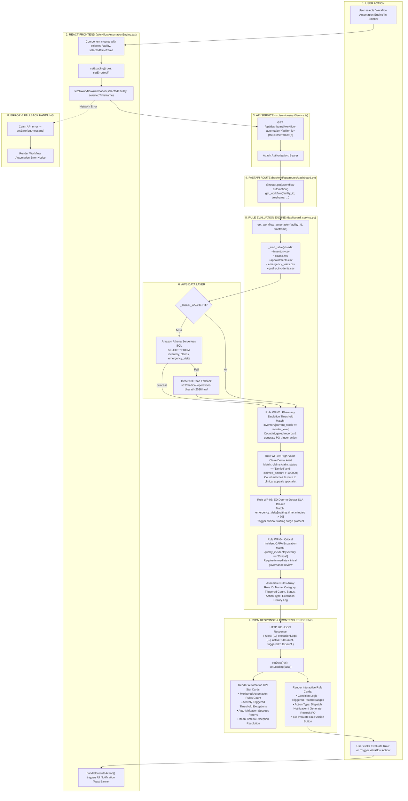

# Workflow Automation Engine Workflow

This diagram visualizes the live rule evaluation engine in `WorkflowAutomationEngine.tsx` and `backend/app/services/dashboard_service.py`.

---

## 📋 Execution Summary

* **Frontend Component**: [`src/components/modules/WorkflowAutomationEngine.tsx`](file:///D:/Development-of-Healthcare-Operations-Intelligence-Dashboard-with-Decision-Analytics/src/components/modules/WorkflowAutomationEngine.tsx).
* **API Endpoint**: `GET /api/dashboard/workflow-automation?facility_id={fac}&timeframe={tf}`.
* **Backend Handler**: `get_workflow_automation()` in [`backend/app/services/dashboard_service.py`](file:///D:/Development-of-Healthcare-Operations-Intelligence-Dashboard-with-Decision-Analytics/backend/app/services/dashboard_service.py#L2030-L2150).
* **Rule Engine**: Evaluates four operational threshold conditions across inventory, claims, emergency visits, and clinical quality incidents against active data tables.
* **Action Realism**: Action buttons trigger feedback via toast banners (`handleExecuteAction`) rather than mutating third-party transactional hospital systems.
