# Automation Pipeline Visualizer Workflow

This diagram visualizes the telemetry status monitor in `AutomationPipelineVisualizer.tsx` and `backend/app/services/dashboard_service.py`.

```mermaid
flowchart TD
    %% USER ACTION
    subgraph USER_ACTION["1. USER ACTION"]
        UserNav["User clicks 'Data -> AI -> Auto Pipeline' in Sidebar"]
    end

    %% REACT FRONTEND
    subgraph REACT_FRONTEND["2. REACT FRONTEND (AutomationPipelineVisualizer.tsx)"]
        Mount["Component mounts with selectedFacility, selectedTimeframe"]
        SetLoading["setLoading(true), setError(null)"]
        CallAPI["fetchPipelineStatus(selectedFacility, selectedTimeframe)"]
    end

    %% API SERVICE
    subgraph API_SERVICE["3. API SERVICE (src/services/apiService.ts)"]
        Req["GET /api/dashboard/pipeline-status?facility_id={fac}&timeframe={tf}"]
        Auth["Attach Authorization: Bearer <token>"]
    end

    %% FASTAPI BACKEND
    subgraph FASTAPI_BACKEND["4. FASTAPI ROUTE (backend/app/routes/dashboard.py)"]
        RoutePipeline["@router.get('/pipeline-status')<br/>get_pipeline(facility_id, timeframe, ...)"]
    end

    %% ANALYTICS ENGINE
    subgraph ANALYTICS_ENGINE["5. PIPELINE TELEMETRY ENGINE (dashboard_service.py)"]
        ServiceFunc["get_pipeline_status(facility_id, timeframe)"]
        
        Stage1["Stage 1: Multi-Facility Data Ingestion<br/>Status: Healthy · S3 Buckets Active (41 Tables) · Latency: 32ms"]
        
        Stage2["Stage 2: Serverless Distributed SQL Query Engine<br/>Status: Operational · Amazon Athena & AWS Glue Data Catalog · Latency: 120ms"]
        
        Stage3["Stage 3: Analytical Decision & Aggregation Engine<br/>Status: Active · FastAPI & Pandas Vectorized In-Memory Computing · Latency: 15ms"]
        
        Stage4["Stage 4: Automated Trigger & Policy Action Gateway<br/>Status: Standby · Threshold Rules & Webhook Monitors active · Latency: 22ms"]
        
        ComputeOverall["Assemble Pipeline Health Index (e.g. 98.4%) & End-to-End Latency"]
    end

    %% RESPONSE & UI
    subgraph RESPONSE_AND_UI["6. JSON RESPONSE & FRONTEND RENDERING"]
        JSONRes["HTTP 200 JSON Response:<br/>{ stages: [...], overallStatus, throughputRecords, avgEndToEndLatency }"]
        UpdateState["setData(res), setLoading(false)"]
        RenderPipeline["Render 4-Stage Closed-Loop Visual Pipeline:<br/>• Step 1: Raw Ingestion (AWS S3 & 5 Regional Clinics)<br/>• Step 2: Distributed Querying (AWS Athena & Glue)<br/>• Step 3: Decision Engine (FastAPI & Operational Rules)<br/>• Step 4: Exception Mitigation (Notification Dispatch)"]
        RenderMetrics["Render Stage Telemetry Panels:<br/>• Active Status Badges (Operational / Standby)<br/>• Stage Latency Indicators · Record Counts Scanned"]
    end

    %% ERROR & FALLBACK
    subgraph ERROR_HANDLING["7. ERROR & FALLBACK HANDLING"]
        CatchErr["Catch API error -> setError(err.message)"]
        ShowError["Render Pipeline Monitor Error Box"]
    end

    %% CONNECTIONS
    UserNav --> Mount
    Mount --> SetLoading
    SetLoading --> CallAPI
    CallAPI --> Req
    Req --> Auth
    Auth --> RoutePipeline
    RoutePipeline --> ServiceFunc

    ServiceFunc --> Stage1 --> Stage2 --> Stage3 --> Stage4
    Stage4 --> ComputeOverall
    ComputeOverall --> JSONRes
    JSONRes --> UpdateState
    UpdateState --> RenderPipeline & RenderMetrics

    CallAPI -. "Network Error" .-> CatchErr --> ShowError
```

---

## 📋 Execution Summary

* **Frontend Component**: [`src/components/modules/AutomationPipelineVisualizer.tsx`](file:///D:/Development-of-Healthcare-Operations-Intelligence-Dashboard-with-Decision-Analytics/src/components/modules/AutomationPipelineVisualizer.tsx).
* **API Endpoint**: `GET /api/dashboard/pipeline-status?facility_id={fac}&timeframe={tf}`.
* **Backend Handler**: `get_pipeline_status()` in [`backend/app/services/dashboard_service.py`](file:///D:/Development-of-Healthcare-Operations-Intelligence-Dashboard-with-Decision-Analytics/backend/app/services/dashboard_service.py#L2152-L2280).
* **Pipeline Stages Visualized**:
  1. Ingestion: S3 Raw Data Lake & 5 Regional Clinics.
  2. Query Engine: Amazon Athena & AWS Glue Data Catalog.
  3. Decision Engine: FastAPI Vectorized Computing & Heuristic Analytics.
  4. Action Gateway: Automated Exception Dispatch & Workflow Handlers.
