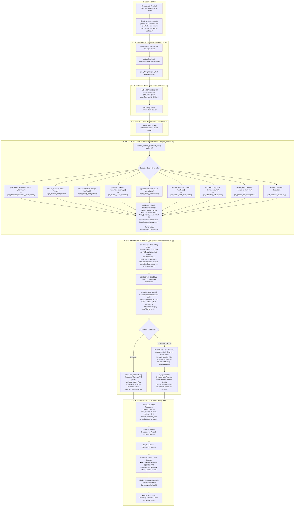

# Medical Operations AI Agent Tab Workflow

This diagram visualizes the complete execution flow of the **Dedicated AI Copilot Tab** (`src/components/modules/MedicalOpsAIAgentTab.tsx`), including Amazon Bedrock Nova Lite invocation and deterministic analytics failover.

---

## 📋 Execution Summary

* **Frontend Component**: [`src/components/modules/MedicalOpsAIAgentTab.tsx`](file:///D:/Development-of-Healthcare-Operations-Intelligence-Dashboard-with-Decision-Analytics/src/components/modules/MedicalOpsAIAgentTab.tsx).
* **API Endpoint**: `POST /api/copilot/query`.
* **Backend Controller**: [`backend/app/routes/copilot.py`](file:///D:/Development-of-Healthcare-Operations-Intelligence-Dashboard-with-Decision-Analytics/backend/app/routes/copilot.py#L14-L21).
* **Business Logic**: [`backend/app/services/copilot_service.py`](file:///D:/Development-of-Healthcare-Operations-Intelligence-Dashboard-with-Decision-Analytics/backend/app/services/copilot_service.py#L31-L366).
* **AWS Client**: [`backend/app/aws/bedrock.py`](file:///D:/Development-of-Healthcare-Operations-Intelligence-Dashboard-with-Decision-Analytics/backend/app/aws/bedrock.py#L9-L65).
* **Configured Model**: `amazon.nova-lite-v1:0` in `us-east-1`.
* **Zero Hallucination Guarantee**: Bedrock is never asked to perform raw database querying or mathematical calculations; deterministic Python analytics runs first, providing structured factual evidence that the LLM summarizes.
* **Deterministic Failover**: If Bedrock encounters timeouts, network interruptions, or expired credentials, `bedrock_used` flips to `false` and the user receives verified deterministic figures without crashing.
