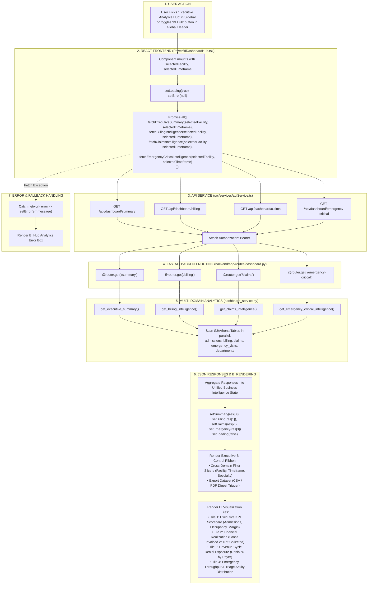

# Executive Analytics Hub (Power BI Hub) Workflow

This diagram visualizes the multi-domain aggregation workflow in `PowerBIDashboardHub.tsx`.

---

## 📋 Execution Summary

* **Frontend Component**: [`src/components/modules/PowerBIDashboardHub.tsx`](file:///D:/Development-of-Healthcare-Operations-Intelligence-Dashboard-with-Decision-Analytics/src/components/modules/PowerBIDashboardHub.tsx).
* **API Endpoints Aggregated**:
  1. `GET /api/dashboard/summary`
  2. `GET /api/dashboard/billing`
  3. `GET /api/dashboard/claims`
  4. `GET /api/dashboard/emergency-critical`
* **Architecture**: Implements a client-side composite BI workspace, executing parallel asynchronous requests across multiple hospital operational domains to deliver unified executive visibility.
