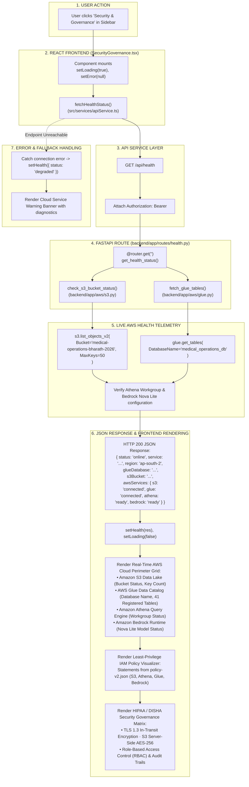

# Security & Governance Workflow

This diagram visualizes the health probing, IAM permission verification, and compliance posture workflow in `SecurityGovernance.tsx`.

---

## 📋 Execution Summary

* **Frontend Component**: [`src/components/modules/SecurityGovernance.tsx`](file:///D:/Development-of-Healthcare-Operations-Intelligence-Dashboard-with-Decision-Analytics/src/components/modules/SecurityGovernance.tsx).
* **API Endpoint**: `GET /api/health`.
* **Backend Route**: [`backend/app/routes/health.py`](file:///D:/Development-of-Healthcare-Operations-Intelligence-Dashboard-with-Decision-Analytics/backend/app/routes/health.py).
* **AWS Helpers**: [`backend/app/aws/s3.py`](file:///D:/Development-of-Healthcare-Operations-Intelligence-Dashboard-with-Decision-Analytics/backend/app/aws/s3.py) and [`backend/app/aws/glue.py`](file:///D:/Development-of-Healthcare-Operations-Intelligence-Dashboard-with-Decision-Analytics/backend/app/aws/glue.py).
* **Governance Visualized**: Live connection status of the AWS data perimeter, rendered IAM policy statements ([`policy-v2.json`](file:///D:/Development-of-Healthcare-Operations-Intelligence-Dashboard-with-Decision-Analytics/policy-v2.json)), and healthcare regulatory audit rules.
