# Enterprise Integrations Hub Workflow

This diagram visualizes the live connection telemetry and staging integration adapters in `IntegrationsHub.tsx`.

```mermaid
flowchart TD
    %% USER ACTION
    subgraph USER_ACTION["1. USER ACTION"]
        UserNav["User clicks 'Enterprise Integrations Hub' in Sidebar"]
        ClickPing["User clicks 'Test Connection / Ping' on an Integration Card"]
    end

    %% REACT FRONTEND
    subgraph REACT_FRONTEND["2. REACT FRONTEND (IntegrationsHub.tsx)"]
        Mount["Component mounts<br/>setLoading(true)"]
        CallStatusAPI["fetchIntegrationsStatus()"]
        CallPingAPI["pingIntegrationEndpoint(serviceName)"]
    end

    %% API SERVICE
    subgraph API_SERVICE["3. API SERVICE LAYER (src/services/apiService.ts)"]
        ReqStatus["GET /api/dashboard/integrations-status"]
        ReqPing["POST /api/dashboard/integrations-ping<br/>Body: { name: serviceName }"]
        Auth["Attach Authorization: Bearer <token>"]
    end

    %% FASTAPI BACKEND
    subgraph FASTAPI_BACKEND["4. FASTAPI ROUTES (backend/app/routes/dashboard.py)"]
        RouteStatus["@router.get('/integrations-status')<br/>get_integrations()"]
        RoutePing["@router.post('/integrations-ping')<br/>post_integrations_ping(payload)"]
    end

    %% ANALYTICS ENGINE
    subgraph ANALYTICS_ENGINE["5. BACKEND INTEGRATION ENGINE (dashboard_service.py)"]
        GetStatusFunc["get_integrations_status():<br/>1. Probe S3 & Glue via AWS SDK<br/>2. Return status for 9 configured adapters"]
        
        PingFunc["ping_integration_service(name):<br/>Measure round-trip execution latency<br/>Check backend connectivity"]
        
        StatusList["Integrations Evaluated:<br/>1. Local CSV Dataset Engine -> CONNECTED / OFFLINE<br/>2. AWS S3 Data Lake -> CONNECTED / STANDBY<br/>3. AWS Glue Data Catalog -> CONNECTED / STANDBY<br/>4. AWS Athena Query Engine -> CONNECTED / STANDBY<br/>5. AWS Bedrock AI Foundation -> CONNECTED / STANDBY<br/>6. Epic EMR / EHR System -> CONFIGURED_STAGING<br/>7. Cerner Millennium -> CONFIGURED_STAGING<br/>8. AthenaHealth RCM Engine -> CONFIGURED_STAGING<br/>9. Twilio WhatsApp Gateway -> CONFIGURED_STAGING"]
    end

    %% RESPONSE & UI
    subgraph RESPONSE_AND_UI["6. JSON RESPONSE & FRONTEND RENDERING"]
        JSONStatusRes["HTTP 200 JSON Response:<br/>{ integrations: [...], cloudActive, localEngineActive }"]
        JSONPingRes["HTTP 200 JSON Response:<br/>{ success: true, latencyMs: 24.5, timestamp: '...' }"]
        UpdateState["setIntegrations(res.integrations), setLoading(false)"]
        RenderCards["Render Enterprise Integration Cards:<br/>• Live Cloud Adapters (S3, Glue, Athena, Bedrock)<br/>• Staging Enterprise Connectors (Epic, Cerner, AthenaHealth)<br/>• Live Latency Indicators (e.g. 35ms, 45ms)<br/>• Status Pills: CONNECTED vs CONFIGURED_STAGING"]
        RenderPingResult["Render Live Ping Toast / Badge:<br/>'Ping Successful · Roundtrip Latency: 24.5ms'"]
    end

    %% CONNECTIONS
    UserNav --> Mount
    Mount --> CallStatusAPI
    CallStatusAPI --> ReqStatus
    ReqStatus --> Auth
    Auth --> RouteStatus
    RouteStatus --> GetStatusFunc
    GetStatusFunc --> StatusList
    StatusList --> JSONStatusRes
    JSONStatusRes --> UpdateState
    UpdateState --> RenderCards

    ClickPing --> CallPingAPI
    CallPingAPI --> ReqPing
    ReqPing --> Auth
    Auth --> RoutePing
    RoutePing --> PingFunc
    PingFunc --> JSONPingRes
    JSONPingRes --> RenderPingResult
```

---

## 📋 Execution Summary

* **Frontend Component**: [`src/components/modules/IntegrationsHub.tsx`](file:///D:/Development-of-Healthcare-Operations-Intelligence-Dashboard-with-Decision-Analytics/src/components/modules/IntegrationsHub.tsx).
* **API Endpoints**: `GET /api/dashboard/integrations-status` and `POST /api/dashboard/integrations-ping`.
* **Backend Handlers**: `get_integrations_status()` and `ping_integration_service()` in [`backend/app/services/dashboard_service.py`](file:///D:/Development-of-Healthcare-Operations-Intelligence-Dashboard-with-Decision-Analytics/backend/app/services/dashboard_service.py#L3172-L3320).
* **Genuine vs. Staged Reality**:
  * **Genuine Live Telemetry**: AWS S3, AWS Glue, AWS Athena, AWS Bedrock, and Local CSV engine.
  * **Configured Staging Interfaces**: Epic EMR, Cerner Millennium, AthenaHealth RCM, and Twilio SMS Gateway (architecture-ready connectors for production deployment).
