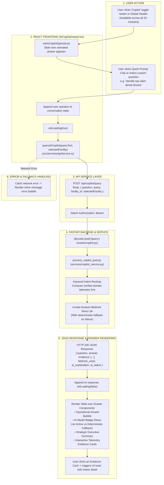

# AI Copilot Drawer Workflow

This diagram visualizes the slide-over AI Copilot drawer interface (`src/components/copilot/AICopilotDrawer.tsx`).

---

## 📋 Execution Summary

* **Frontend Component**: [`src/components/copilot/AICopilotDrawer.tsx`](file:///D:/Development-of-Healthcare-Operations-Intelligence-Dashboard-with-Decision-Analytics/src/components/copilot/AICopilotDrawer.tsx).
* **Activation**: Toggled globally via the `Header.tsx` Copilot action button, maintaining conversation state across module changes.
* **Backend Endpoint**: `POST /api/copilot/query`.
* **Visual Elements**: Animated slide-over sheet, suggestion query pills, conversational bubble history, live Bedrock/Fallback status indicators, and structured metric evidence cards.
