# Enterprise Multi-Department Drilldown Workflow

This diagram visualizes the multi-department operational drilldown matrix in `EnterpriseDrilldownModal.tsx`.

```mermaid
flowchart TD
    %% USER ACTION
    subgraph USER_ACTION["1. USER ACTION"]
        TriggerModal["User clicks 'Deep Drilldown' or a Facility Row<br/>in Executive Command Center"]
        SelectDept["User selects specific Department tab in Modal<br/>(Cardiology, Emergency, Neurology, Oncology, Orthopedics, Pediatrics)"]
    end

    %% REACT FRONTEND
    subgraph REACT_FRONTEND["2. REACT FRONTEND (EnterpriseDrilldownModal.tsx)"]
        OpenModal["isOpen = true, initialFacilityId passed as prop"]
        SetLoading["setLoading(true), setError(null)"]
        CallAPI["fetchOperationsDrilldown(facilityId, selectedDept, timeframe)<br/>(src/services/apiService.ts)"]
    end

    %% API SERVICE
    subgraph API_SERVICE["3. API SERVICE LAYER"]
        Req["GET /api/dashboard/drilldown?facility_id={fac}&department={dept}&timeframe={tf}"]
        Auth["Attach Authorization: Bearer <token>"]
    end

    %% FASTAPI BACKEND
    subgraph FASTAPI_BACKEND["4. FASTAPI ROUTE (backend/app/routes/dashboard.py)"]
        RouteDrilldown["@router.get('/drilldown')<br/>get_drilldown(facility_id, department, timeframe, ...)"]
    end

    %% ANALYTICS ENGINE
    subgraph ANALYTICS_ENGINE["5. DRILLDOWN ENGINE (dashboard_service.py)"]
        ServiceFunc["get_operations_drilldown(facility_id, department, timeframe)"]
        
        LoadData["_load_table() loads:<br/>• admissions.csv<br/>• billing.csv<br/>• emergency_visits.csv<br/>• doctor_workload.csv<br/>• departments.csv"]
        
        FilterData["Filter by facility_id and department_name"]
        
        CalcMatrix["Compute Department Matrix:<br/>• deptAdmissions = len(df_adm)<br/>• deptRevenue = _safe_sum(df_bil, 'net_amount')<br/>• deptAvgLOS = _safe_mean(df_adm, 'length_of_stay_days')<br/>• physicianUtilization = _safe_mean(df_dw, 'utilization_pct')<br/>• bedOccupancy = admissions / department_bed_capacity"]
    end

    %% RESPONSE & UI
    subgraph RESPONSE_AND_UI["6. JSON RESPONSE & MODAL RENDERING"]
        JSONRes["HTTP 200 JSON Response:<br/>{ department, facilityId, metrics: {...}, staffRoster: [...], dailyTrend: [...] }"]
        UpdateState["setData(res), setLoading(false)"]
        
        RenderModal["Render Enterprise Drilldown Modal:<br/>• Department Tab Bar (Clinical Specialties)<br/>• Department Metric Rollup Cards (Admissions, Revenue, LOS, Occupancy)<br/>• Departmental 14-Day Admissions Trend Curve<br/>• Department Physician & Staff Shift Roster"]
    end

    %% ERROR & FALLBACK
    subgraph ERROR_HANDLING["7. ERROR & FALLBACK HANDLING"]
        CatchErr["Catch API error -> setError(err.message)"]
        ShowError["Render Drilldown Error Notice"]
    end

    %% CONNECTIONS
    TriggerModal --> OpenModal
    OpenModal --> SetLoading
    SelectDept --> SetLoading
    SetLoading --> CallAPI
    CallAPI --> Req
    Req --> Auth
    Auth --> RouteDrilldown
    RouteDrilldown --> ServiceFunc
    ServiceFunc --> LoadData
    LoadData --> FilterData
    FilterData --> CalcMatrix
    CalcMatrix --> JSONRes
    JSONRes --> UpdateState
    UpdateState --> RenderModal

    CallAPI -. "Network Error" .-> CatchErr --> ShowError
```

---

## 📋 Execution Summary

* **Frontend Component**: [`src/components/modals/EnterpriseDrilldownModal.tsx`](file:///D:/Development-of-Healthcare-Operations-Intelligence-Dashboard-with-Decision-Analytics/src/components/modals/EnterpriseDrilldownModal.tsx).
* **API Endpoint**: `GET /api/dashboard/drilldown?facility_id={fac}&department={dept}&timeframe={tf}`.
* **Backend Handler**: `get_operations_drilldown()` in [`backend/app/services/dashboard_service.py`](file:///D:/Development-of-Healthcare-Operations-Intelligence-Dashboard-with-Decision-Analytics/backend/app/services/dashboard_service.py#L2282-L2450).
* **Features**: Multi-department tab switcher (Cardiology, Emergency, Neurology, Oncology, Orthopedics, Pediatrics), clinical staff roster breakdown, and department-isolated revenue and bed occupancy metrics.
